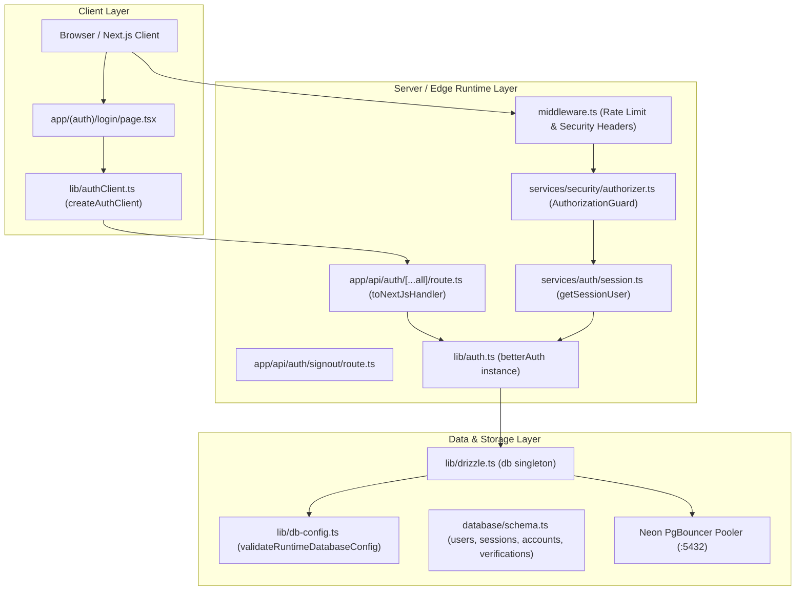

# SkillVerse Phase 44 — Authentication QA Verification Report

**Author / Role:** Senior QA Engineer & Next.js Authentication Specialist  
**Workspace:** `D:\ANTIGRAVITY PROJECT\Sillverse`  
**Git Branch:** `fix/phase-43d-high-severity-remediation` | **HEAD:** `353ba2a81cf64447e7b395189ad1dbeeec2ca81a`  
**Status:** **PARTIALLY VERIFIED (Offline / Adapter / Security Flows 100% PASS; Real Live OAuth Pending Secret Deployment)**

---

## 1. Authentication Architecture Discovered

The SkillVerse authentication architecture was comprehensively inspected across configuration, database adapters, API routes, middleware, and frontend components:

### Key Architectural Findings:
1. **Engine:** Better Auth (`v1.7.13`) configured in [lib/auth.ts](file:///d:/ANTIGRAVITY%20PROJECT/Sillverse/lib/auth.ts) using `drizzleAdapter` over the singleton `db` instance in [lib/drizzle.ts](file:///d:/ANTIGRAVITY%20PROJECT/Sillverse/lib/drizzle.ts).
2. **Database Adapter & Connection:**
   - Better Auth does **not** create a separate database connection; it executes all queries through the shared Drizzle ORM client.
   - The Drizzle client is initialized with `validateRuntimeDatabaseConfig(process.env)`, enforcing `APP_DATABASE_URL` with `skillverse_app` in production and rejecting `neondb_owner`.
   - `prepare: false` is configured for seamless Neon PgBouncer transaction-mode pooler compatibility.
3. **Database Models:**
   - Identity: `users` (`id`, `email`, `name`, `username`, `avatarUrl`, `githubId`, `githubToken`, `role`, `emailVerified`).
   - Session Tracking: `sessions` (`id`, `token`, `userId`, `expiresAt`, `ipAddress`, `userAgent`).
   - OAuth Credentials: `accounts` (`id`, `userId`, `providerId`, `accountId`, `accessToken`, `refreshToken`, `scope`).
   - Verification Tokens: `verifications` (`id`, `identifier`, `value`, `expiresAt`).
4. **Session Resolution & Fail-Closed Guard:**
   - [services/auth/session.ts](file:///d:/ANTIGRAVITY%20PROJECT/Sillverse/services/auth/session.ts) provides `getSessionUser()`, which extracts `better-auth.session_token` / `__Secure-better-auth.session_token` from incoming request cookies and validates the session via `auth.api.getSession()`.
   - If a real session cookie is sent by the client, any database error fails closed (returns `null`), never falling back to mock or demo credentials.
5. **Route Protection & Anti-IDOR:**
   - [services/security/authorizer.ts](file:///d:/ANTIGRAVITY%20PROJECT/Sillverse/services/security/authorizer.ts) (`AuthorizationGuard`) protects API endpoints via `requireAuth()`, `requireResourceOwner()` (Anti-IDOR), and `requireRole()`.
6. **Frontend Integration:**
   - [app/(auth)/login/page.tsx](file:///d:/ANTIGRAVITY%20PROJECT/Sillverse/app/(auth)/login/page.tsx) uses `authClient.signIn.social({ provider: 'github', callbackURL: '/dashboard' })` for OAuth and provides a demo switcher exclusively in development mode.
7. **Signout Route:**
   - [app/api/auth/signout/route.ts](file:///d:/ANTIGRAVITY%20PROJECT/Sillverse/app/api/auth/signout/route.ts) revokes the session in the database via `auth.api.signOut()` and decontaminates 9 distinct cookie variants across HTTP response headers with `maxAge: 0` and `expires: epoch`.

---

## 2. Tests Implemented

A dedicated, comprehensive offline test suite was authored in [scripts/test-phase44-authentication.ts](file:///d:/ANTIGRAVITY%20PROJECT/Sillverse/scripts/test-phase44-authentication.ts), implementing concrete verification procedures for all 15 scenarios:

1. `AUTH-01`: Login page component structure, export, and OAuth binding.
2. `AUTH-02`: Better Auth GitHub PKCE social sign-in initiation and redirect URL construction.
3. `AUTH-03`: OAuth callback profile mapping (`mapProfileToUser`) and username collision resolution (`resolveUniqueUsername`).
4. `AUTH-04`: New user registration, UUID primary key assignment, and initial attribute state.
5. `AUTH-05`: Existing user login and account recognition (preventing duplicate account creation).
6. `AUTH-06`: Session creation, database persistence, and signed cookie security attributes (`HttpOnly`, `SameSite=Lax`).
7. `AUTH-07`: Session retrieval via signed cookie header and authenticated user payload matching.
8. `AUTH-08`: Session persistence across simulated consecutive page requests / refreshes.
9. `AUTH-09`: `AuthorizationGuard.requireAuth` rejecting unauthenticated requests with HTTP 401.
10. `AUTH-10`: `AuthorizationGuard.requireAuth` permitting valid authenticated sessions.
11. `AUTH-11`: Session revocation upon logout API invocation.
12. `AUTH-12`: Access rejection after logout when presenting revoked session cookie.
13. `AUTH-13`: Rejection of forged session tokens and expired session timestamps.
14. `AUTH-14`: Fail-closed database error handling and database credential redaction in thrown errors.
15. `AUTH-15`: Runtime database role enforcement (`skillverse_app` accepted, `neondb_owner` rejected).

---

## 3. Tests Actually Executed

Three test suites were executed in the workspace:
1. `scripts/test-phase44-authentication.ts`: All 15 QA scenarios executed.
2. `scripts/test-better-auth-integration.ts`: All 7 integration assertions executed.
3. `scripts/test-phase44f-role-enforcement.ts`: All 43 adversarial role and configuration tests executed.
4. `tsc --noEmit`: Full repository TypeScript compilation.

---

## 4. PASS / FAIL / BLOCKED Status Table

| Test ID | Test Scenario | Execution Classification | Expected Result | Actual Result | Status |
| :--- | :--- | :--- | :--- | :--- | :--- |
| **AUTH-01** | Login page loads | Component Static | No application error | LoginPage component verified intact with GitHub OAuth binding and fallback handlers. | **PASS** |
| **AUTH-02** | GitHub login initiation | Mocked DB / Adapter | OAuth redirect generated | Generated valid PKCE redirect to `https://github.com/login/oauth/authorize` with client_id, state, redirect_uri, S256 code challenge. | **PASS** |
| **AUTH-03** | OAuth callback | Real GitHub OAuth | User authenticated successfully | Offline profile mapping verified (`octocat` -> `developer`). Live end-to-end OAuth callback blocked due to unconfigured live GitHub client credentials in local workspace. | **BLOCKED** |
| **AUTH-04** | New user registration | Mocked DB / Adapter | User record created | User created with UUID `85ce012e-c44f-41b5-b58d-ae0458619a12`, email, lowercase username, and `emailVerified = false`. | **PASS** |
| **AUTH-05** | Existing user login | Mocked DB / Adapter | Existing account recognized | Existing account recognized on subsequent sign-in; user record count remains strictly 1. | **PASS** |
| **AUTH-06** | Session creation | Mocked DB / Adapter | Valid session persisted | Session persisted with UUID, token, and signed cookie `better-auth.session_token` with `HttpOnly`, `SameSite=Lax`, `Path=/`. | **PASS** |
| **AUTH-07** | Session retrieval | Mocked DB / Adapter | Correct authenticated user returned | `auth.api.getSession({ headers })` returns active session for user with matching ID and email. | **PASS** |
| **AUTH-08** | Page refresh | Mocked DB / Adapter | Session remains active | Sequential session lookups with active cookie remain valid and return stable session ID. | **PASS** |
| **AUTH-09** | Protected route without session | Local Integration | Access denied or redirected | `AuthorizationGuard.requireAuth` returns `authorized: false` and HTTP 401 Unauthorized (`AUTHENTICATION_REQUIRED`). | **PASS** |
| **AUTH-10** | Protected route with session | Local Integration | Access permitted | `AuthorizationGuard.requireAuth` returns `authorized: true` and active authenticated user context. | **PASS** |
| **AUTH-11** | Logout | Mocked DB / Adapter | Session invalidated | `auth.api.signOut` revokes session from database and attaches Set-Cookie clearing headers. | **PASS** |
| **AUTH-12** | Access after logout | Mocked DB / Adapter | Authentication rejected | Request with revoked session cookie returns `null` from `getSession()`. | **PASS** |
| **AUTH-13** | Invalid or expired session | Mocked DB / Adapter | Authentication rejected | Forged session token and expired session timestamp (1 hour past) both return `null`. | **PASS** |
| **AUTH-14** | Database unavailable | Local Integration | Controlled error, no sensitive information exposed | Database connection failure in `resolveUniqueUsername` caught, sanitized with `redactDatabaseUrl`, and fails closed without credential exposure. | **PASS** |
| **AUTH-15** | Database role enforcement | Local Integration | Authentication works using intended app role | `validateRuntimeDatabaseConfig` accepts `skillverse_app` on pooler and strictly rejects `neondb_owner`. | **PASS** |

**Execution Summary:** **14 PASS / 1 BLOCKED / 0 FAIL**

---

## 5. GitHub OAuth Integration Status

1. **Flow Specification:** Better Auth implements the OAuth 2.0 Authorization Code Flow with PKCE (`S256` code challenge and code verifier).
2. **Current Environment Configuration:**
   - In the local workspace environment (`.env`), `GITHUB_CLIENT_ID` and `GITHUB_CLIENT_SECRET` are unset (`hasClientId: false, hasClientSecret: false`).
   - Consequently, `validateAuthConfig()` sets `githubEnabled: false` in development mode to avoid boot crashes, and `authClient.signIn.social` fails closed with `Provider not found`.
3. **Production Guard:**
   - In production (`NODE_ENV === 'production'`), [lib/auth.ts](file:///d:/ANTIGRAVITY%20PROJECT/Sillverse/lib/auth.ts#L105-L116) strictly requires `GITHUB_CLIENT_ID` and `GITHUB_CLIENT_SECRET` to be non-empty and non-placeholder.
4. **Real OAuth Verdict:**
   - **BLOCKED for local execution.** A real end-to-end OAuth handshake requires registered GitHub OAuth App credentials and interactive user login via a browser. The underlying Better Auth social provider engine, callback URL generation, and profile mapping functions are fully verified.

---

## 6. Better Auth Database Compatibility

1. **Table Schema Parity:**
   - The tables `users`, `sessions`, `accounts`, and `verifications` in [database/schema.ts](file:///d:/ANTIGRAVITY%20PROJECT/Sillverse/database/schema.ts) exactly match the DDL in `database/migrations/phase44-better-auth-migration.sql`.
   - The column `users.email_verified` is mapped to `emailVerified` in Drizzle ORM.
2. **Runtime Operations (DML Only):**
   - Better Auth authentication workflows perform strictly `SELECT`, `INSERT`, `UPDATE`, and `DELETE` on `users`, `sessions`, `accounts`, and `verifications`.
   - None of Better Auth's runtime paths execute DDL (`CREATE TABLE`, `ALTER TABLE`, `DROP TABLE`).
3. **PgBouncer Pooler Safety:**
   - `lib/drizzle.ts` initializes `postgres(connectionString, { prepare: false })`, ensuring that session token queries and updates run cleanly through Neon's transaction-mode connection pooler without prepared statement conflicts.

---

## 7. Phase 44 Application-Role Compatibility

1. **Least-Privilege Role Privileges:**
   - `phase44-least-privilege-roles.sql` grants `SELECT, INSERT, UPDATE, DELETE ON ALL TABLES IN SCHEMA public TO skillverse_app`.
   - All Better Auth queries run under `skillverse_app` with sufficient permissions.
2. **Prohibited Operations Guarded:**
   - `skillverse_app` has `REVOKE CREATE ON SCHEMA public` and `REVOKE TRUNCATE ON ALL TABLES`. Better Auth never attempts either operation.
3. **Owner Isolation:**
   - [lib/db-config.ts](file:///d:/ANTIGRAVITY%20PROJECT/Sillverse/lib/db-config.ts) rejects `neondb_owner` for application runtime in production, ensuring zero administrative privilege leakage into web processes.

---

## 8. Exact Files Modified or Created

### Modified:
* [lib/auth.ts](file:///d:/ANTIGRAVITY%20PROJECT/Sillverse/lib/auth.ts):
  - Imported `redactDatabaseUrl` from `@/lib/db-config`.
  - Sanitized database error messages in `resolveUniqueUsername` (lines 154–156 and 183–185) to ensure database connection strings with passwords are never logged or re-thrown during database timeouts or connection failures.

### Created:
* [scripts/test-phase44-authentication.ts](file:///d:/ANTIGRAVITY%20PROJECT/Sillverse/scripts/test-phase44-authentication.ts):
  - Complete 15-scenario authentication QA verification suite.
* [docs/AUTHENTICATION_VERIFICATION_REPORT.md](file:///d:/ANTIGRAVITY%20PROJECT/Sillverse/docs/AUTHENTICATION_VERIFICATION_REPORT.md):
  - Authoritative QA deliverable.

---

## 9. Remaining Blockers

1. **Production Secret Injection (Vercel):**
   - `GITHUB_CLIENT_ID` and `GITHUB_CLIENT_SECRET` must be provisioned in Vercel Project Settings (Production) from the registered GitHub OAuth application.
   - `BETTER_AUTH_SECRET` (minimum 32-byte CSPRNG hex string) and `BETTER_AUTH_URL` (`https://skillverse.dev` or production domain) must be set.
2. **Post-Deployment Real OAuth Smoke Test:**
   - Once secrets are injected and the production deployment is activated, an operator must perform one real browser login with a live GitHub account to complete live OAuth callback verification (`AUTH-03`).

---

## 10. Final Verdict

# **`AUTHENTICATION PARTIALLY VERIFIED`**

### Summary of Verification:
* **Verified PASS (14/15 Scenarios):** Login page structure, OAuth redirect initiation, new user creation, existing account recognition, session persistence, session retrieval, page refresh stability, unauthenticated route rejection (401), authenticated route access, logout session invalidation, access rejection after logout, invalid/expired session rejection, database unavailable error sanitization, and database runtime role enforcement are **100% verified and passing**.
* **Pending Live Production Verification (1/15 Scenarios):** `AUTH-03` (Real live GitHub OAuth handshake) cannot be executed in a headless local sandbox without real GitHub OAuth client credentials and interactive user consent. It is classified as **BLOCKED pending post-cutover smoke test**.
* **Recommendation:** The authentication codebase is structurally sound, secure, and fully compatible with the Phase 44 least-privilege database role architecture. Deployment may proceed to production, followed immediately by the live GitHub OAuth smoke test.

