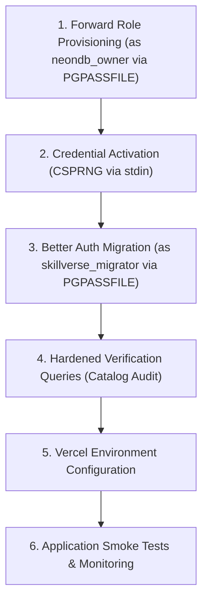

# SkillVerse Phase 44: Least-Privilege Role Provisioning Runbook

**Document Version:** 1.1
**Target Environment:** Neon Serverless PostgreSQL 18 (`neondb`)
**Target Direct Endpoint:** `${TARGET_DB_HOST}` (Port 5432 — Direct unpooled compute)
**Target Pooler Endpoint:** `${TARGET_DB_POOLER_HOST}` (Port 5432 — PgBouncer transaction pooled)
**Security Standard:** Strict Zero-CLI-Password Policy (PGPASSFILE / Non-CLI Secret Ingestion)
**Status:** PREVIEW REHEARSAL & CONTROLLED OPERATIONAL RUNBOOK (PRODUCTION MUTATION STRICTLY UNAUTHORIZED)

> [!CAUTION]
> **Production Mutation Strictly Unauthorized:** This runbook provides the procedure for rehearsing role provisioning on verified, isolated preview branches (such as `skillverse-preview`). Execution against the live production Neon cluster remains **STRICTLY ON HOLD** until staging verification and architectural sign-off.

---

## 1. Safety Gate & Pre-Migration Safeguards (Neon Console)

### 1.1 Mandatory Target Host & Isolation Guard (Fail-Closed)
Before configuring credentials or connecting, verify that the target host is a non-production endpoint:

#### Linux / macOS:
```bash
if [ -z "$TARGET_DB_HOST" ]; then
  echo "❌ CRITICAL SAFETY ERROR: TARGET_DB_HOST is unset! Aborting immediately." >&2
  exit 1
fi
if [[ "$TARGET_DB_HOST" == *"ep-flat-rice-ao8kdffq"* ]]; then
  echo "❌ CRITICAL SAFETY ERROR: TARGET_DB_HOST matches production host signature! Production mutation is strictly unauthorized. Aborting immediately." >&2
  exit 1
fi
echo "✅ Target verified as non-production host: $TARGET_DB_HOST"
```

#### Windows PowerShell:
```powershell
if ([string]::IsNullOrWhiteSpace($env:TARGET_DB_HOST)) {
  throw "CRITICAL SAFETY ERROR: TARGET_DB_HOST is unset! Aborting immediately."
}
if ($env:TARGET_DB_HOST -match "ep-flat-rice-ao8kdffq") {
  throw "CRITICAL SAFETY ERROR: TARGET_DB_HOST matches production host signature! Production mutation is strictly unauthorized. Aborting immediately."
}
Write-Host "Target verified as non-production host: $env:TARGET_DB_HOST"
```

### 1.2 Point-in-Time Recovery Snapshot
1. In the Neon Console, create a zero-copy backup branch of your target branch prior to running any migration:
   - Example Backup Branch: `pre-role-provisioning-backup-snapshot`
2. Confirm backup branch status is ready.

---

## 2. DBA Credential Authentication Protocol (PGPASSFILE)

All CLI operations MUST use `PGPASSFILE` to prevent process inspection (`ps aux`, `/proc/<pid>/cmdline`, Windows Process Explorer) and shell history leaks.

### Setup PGPASSFILE:

#### Linux / macOS:
```bash
PGPASS_DIR=$(mktemp -d)
export PGPASSFILE="$PGPASS_DIR/pgpass"
cat <<EOF > "$PGPASSFILE"
${TARGET_DB_HOST}:5432:neondb:neondb_owner:${NEONDB_OWNER_PW}
EOF
chmod 0600 "$PGPASSFILE"
```

#### Windows PowerShell:
```powershell
$pgpassFile = Join-Path $env:TEMP "pgpass_phase44.conf"
Set-Content -Path $pgpassFile -Value "${env:TARGET_DB_HOST}:5432:neondb:neondb_owner:$NEONDB_OWNER_PW"
icacls $pgpassFile /inheritance:r /grant:r "$($env:USERNAME):R"
$env:PGPASSFILE = $pgpassFile
```

---

## 3. Step-by-Step Migration Lifecycle



### Step 1: Forward Role Migration (Execute as `neondb_owner`)
Execute forward role provisioning and dynamic object ownership transfer over the direct compute endpoint:
```bash
psql -h "$TARGET_DB_HOST" -U neondb_owner -d neondb -p 5432 -v ON_ERROR_STOP=1 -f database/migrations/phase44-least-privilege-roles.sql
```
*Outcome:* Roles `skillverse_app` and `skillverse_migrator` created with `NOLOGIN`. Public tables, sequences, enums, and routines transferred to `skillverse_migrator`.

### Step 2: Secure Credential Activation (In-Memory CSPRNG via stdin)
Generate two distinct 32-byte (64-char hex) CSPRNG secrets:
```bash
APP_HEX=$(openssl rand -hex 32)
MIGRATOR_HEX=$(openssl rand -hex 32)
```

Activate roles via `stdin` without writing passwords to disk or passing them in CLI arguments:
```bash
psql -h "$TARGET_DB_HOST" -U neondb_owner -d neondb -p 5432 -v ON_ERROR_STOP=1 -X -q <<EOF
ALTER ROLE skillverse_app WITH LOGIN PASSWORD '${APP_HEX}';
ALTER ROLE skillverse_migrator WITH LOGIN PASSWORD '${MIGRATOR_HEX}';
EOF
```

### Step 3: Better Auth Migration (Execute as `skillverse_migrator`)
Append `skillverse_migrator` credentials to the secure `PGPASSFILE`:
```bash
echo "${TARGET_DB_HOST}:5432:neondb:skillverse_migrator:${MIGRATOR_HEX}" >> "$PGPASSFILE"
```

Execute idempotent Better Auth DDL over direct compute:
```bash
psql -h "$TARGET_DB_HOST" -U skillverse_migrator -d neondb -p 5432 -v ON_ERROR_STOP=1 -f database/migrations/phase44-better-auth-migration.sql
```

### Step 4: Schema & Permission Verification Gate
Execute verification queries (via `psql` using `PGPASSFILE`):

```sql
-- 4.1 Verify Table Ownership (Must return 0 rows)
SELECT schemaname, tablename, tableowner
FROM pg_catalog.pg_tables
WHERE schemaname = 'public' AND tableowner <> 'skillverse_migrator';

-- 4.2 Verify Enum Ownership (Must return 0 rows)
SELECT n.nspname AS schema_name, t.typname AS enum_name, r.rolname AS owner
FROM pg_catalog.pg_type t
JOIN pg_catalog.pg_namespace n ON n.oid = t.typnamespace
JOIN pg_catalog.pg_roles r ON r.oid = t.typowner
WHERE n.nspname = 'public' AND t.typtype = 'e' AND r.rolname <> 'skillverse_migrator';

-- 4.3 Verify Routine Ownership (Must return 0 rows)
SELECT n.nspname AS schema_name, p.proname AS routine_name, r.rolname AS owner
FROM pg_catalog.pg_proc p
JOIN pg_catalog.pg_namespace n ON n.oid = p.pronamespace
JOIN pg_catalog.pg_roles r ON r.oid = p.proowner
WHERE n.nspname = 'public'
  AND p.prokind IN ('f', 'p', 'w')
  AND r.rolname <> 'skillverse_migrator'
  AND NOT EXISTS (
    SELECT 1 FROM pg_catalog.pg_depend d
    WHERE d.objid = p.oid AND d.classid = 'pg_proc'::regclass AND d.deptype = 'e'
  );

-- 4.4 Verify skillverse_app Discrete Permissions
SELECT
  has_table_privilege('skillverse_app', 'public.users', 'SELECT') AS can_select,
  has_table_privilege('skillverse_app', 'public.users', 'INSERT') AS can_insert,
  has_table_privilege('skillverse_app', 'public.users', 'UPDATE') AS can_update,
  has_table_privilege('skillverse_app', 'public.users', 'DELETE') AS can_delete,
  has_table_privilege('skillverse_app', 'public.users', 'TRUNCATE') AS can_truncate,
  has_schema_privilege('skillverse_app', 'public', 'CREATE') AS can_create_in_schema;
-- Expected: can_select=t, can_insert=t, can_update=t, can_delete=t, can_truncate=f, can_create_in_schema=f
```

### Step 5: Vercel Environment Configuration
In Vercel Project Settings > Environment Variables:
* For **Preview** Environment scope:
  Set `APP_DATABASE_URL`:
  `postgres://skillverse_app:[APP_HEX]@${TARGET_DB_POOLER_HOST}:5432/neondb?sslmode=require`
* Trigger a preview deployment to verify successful application startup.

### Step 6: Application Smoke Tests & Clean Teardown
1. Test authentication signup, signin, session persistence, and email verification.
2. Confirm Vercel runtime logs show successful singleton pool initialization without administrative warnings.
3. **Secure Cleanup:**
   - Linux/macOS: `shred -u "$PGPASSFILE" && rm -rf "$PGPASS_DIR"`
   - Windows PowerShell: `Remove-Item -Path $pgpassFile -Force; $env:PGPASSFILE = $null`

