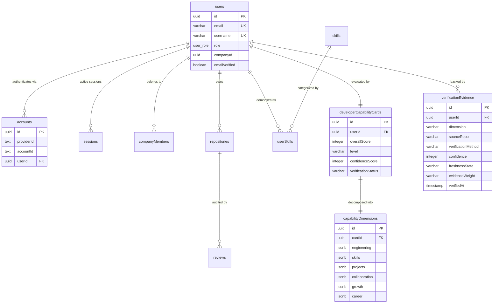

# SKILLVERSE — RBAC & EVIDENCE-BASED DEVELOPER EVALUATION ARCHITECTURE DISCOVERY & AUDIT

**Target System:** SkillVerse Next.js 15 / Better Auth / Neon PostgreSQL Application  
**Workspace:** `D:\ANTIGRAVITY PROJECT\Sillverse`  
**Audit Date:** November 2026  
**Audit Mode:** Read-Only Discovery, Code Inspection & Architectural Formulation  
**Document Status:** Complete & Final Discovery Report  

---

## 1. Executive Summary & Audit Scope

SkillVerse is an enterprise-grade platform designed to evaluate and showcase developer capabilities based on empirical repository analysis, while providing role-scoped experiences for developers, recruiters, hiring organizations, and platform administrators.

This discovery audit investigates two critical architectural domains of SkillVerse:
1. **Role-Based Access Control (RBAC):** Determining why users are currently routed directly to the Developer Dashboard regardless of their assigned role, auditing the existing session, middleware, and route guard implementations, and establishing a unified, secure 4-role access model.
2. **Evidence-Based Developer Evaluation System:** Establishing a mathematically grounded, verifiable evaluation architecture that strictly bifurcates:
   - **Technology-Specific Skill Evaluation** (12 technologies evaluated across objective, language-specific AST and code artifacts).
   - **Universal Developer Capability Evaluation** (8 universal dimensions measuring architectural maturity, craftsmanship, reliability, and security across repositories).

### Non-Destructive Audit Commitment
This discovery has been conducted strictly in **read-only mode**. No application code, database migrations, or persistent schemas were modified during this investigation. Existing uncommitted working-tree changes (Phase 45 P0 remediation and RBAC foundational layouts) have been fully preserved.

---

## 2. Existing RBAC Architecture & Discovered Identity Models

SkillVerse utilizes [Better Auth](https://better-auth.com) backed by Neon Serverless PostgreSQL and Drizzle ORM (`drizzleAdapter`). The core identity infrastructure spans four primary files:

| File Path | Functional Responsibility |
|---|---|
| `database/schema.ts` (lines 4-25, 1415-1456) | Drizzle schema definitions for enums, `users`, `accounts`, `sessions`, `verifications`, and `companyMembers`. |
| `lib/auth.ts` (lines 1-333) | Better Auth initialization, OAuth provider mapping (`github`, `google`), account linking, and DB hooks. |
| `services/auth/session.ts` (lines 1-158) | Request-scoped session resolution, cookie inspection, multi-provider normalization, and demo fallback. |
| `services/security/authorizer.ts` (lines 1-457) | API authorization guards, Anti-IDOR protections, company workspace access checks, and server layout guards. |

### Discovered Database Identity Schema
In [`database/schema.ts`](file:///d:/ANTIGRAVITY%20PROJECT/Sillverse/database/schema.ts#L4-L25):
```typescript
// Line 4: Explicit Postgres Enum
export const userRoleEnum = pgEnum('user_role', ['developer', 'recruiter', 'company_admin', 'admin']);

// Lines 9-25: Core Users Table
export const users = pgTable('users', {
  id: uuid('id').primaryKey().defaultRandom(),
  email: varchar('email', { length: 255 }).notNull().unique(),
  name: varchar('name', { length: 255 }),
  username: varchar('username', { length: 100 }).notNull().unique(),
  avatarUrl: text('avatar_url'),
  githubId: varchar('github_id', { length: 100 }).unique(),
  githubToken: text('github_token'),
  role: userRoleEnum('role').default('developer').notNull(),
  bio: text('bio'),
  website: text('website'),
  location: varchar('location', { length: 255 }),
  companyId: uuid('company_id'),
  emailVerified: boolean('email_verified').default(false).notNull(),
  createdAt: timestamp('created_at').defaultNow().notNull(),
  updatedAt: timestamp('updated_at').defaultNow().notNull(),
});
```

### Better Auth Integration & Role Preservation
In [`lib/auth.ts`](file:///d:/ANTIGRAVITY%20PROJECT/Sillverse/lib/auth.ts#L226-L240), Better Auth is configured with `user.additionalFields`:
```typescript
user: {
  fields: {
    image: 'avatarUrl',
  },
  additionalFields: {
    username: { type: 'string', required: true },
    role: { type: 'string', required: false, defaultValue: 'developer' },
    githubId: { type: 'string', required: false },
    githubToken: { type: 'string', required: false },
    companyId: { type: 'string', required: false },
  },
}
```
When a user signs in via GitHub or Google, `mapProfileToUser` defaults the assigned role to `'developer'`. If the user already exists in the database with a previously promoted role (e.g., `'recruiter'`, `'company_admin'`, or `'admin'`), Better Auth's account linking logic preserves the existing database record and its persisted `role` column, avoiding unwanted demotion.

### Session Resolution & Provider Normalization
In [`services/auth/session.ts`](file:///d:/ANTIGRAVITY%20PROJECT/Sillverse/services/auth/session.ts#L60-L109), `getSessionUser()` queries Better Auth via `auth.api.getSession({ headers: headersList })`.
- The user's role is extracted from `session.user.role` (falling back to `'developer'` if null).
- Linked providers are queried from the `accounts` table (`select({ providerId: accounts.providerId }).from(accounts).where(eq(accounts.userId, u.id))`) to populate `app_metadata.providers`.
- Demo test authentication is fail-closed: disabled unconditionally in `production` mode (`isDemoAuthEnabled()`).

---

## 3. Discovered Roles & Access Model Analysis

The database and business domain define four explicit roles via `userRoleEnum`:

```
                       ┌────────────────────────────────────────────────────────┐
                       │                     Platform Admin                     │
                       │   Global observability, user roles, system telemetry   │
                       └───────────────────────────┬────────────────────────────┘
                                                   │
                         ┌─────────────────────────┴────────────────────────┐
                         │                                                  │
                         ▼                                                  ▼
      ┌────────────────────────────────────┐             ┌────────────────────────────────────┐
      │           Company Admin            │             │             Developer              │
      │ Workspace management, team billing │             │ Code analysis, verified skills,   │
      │    members, company job listings   │             │   trust scores, portfolio, career  │
      └──────────────────┬─────────────────┘             └────────────────────────────────────┘
                         │
                         ▼
      ┌────────────────────────────────────┐
      │             Recruiter              │
      │ Candidate discovery, skill review, │
      │   hiring notes, talent pipelines   │
      └────────────────────────────────────┘
```

### Detailed Functional Profile per Role

1. **`developer` (Talent Persona)**
   - **Core Purpose:** Analyze personal repositories, obtain verified capability credentials, explore career paths, and apply to job opportunities.
   - **Allowed Areas:** `/overview`, `/dashboard`, `/career`, `/skill-dna`, `/skills`, `/projects`, `/github`, `/activity`, `/community`, `/network`, `/profile`, `/jobs`, `/challenges`, `/settings`.
   - **Prohibited Areas:** All `/company/*` workspaces and all `/admin/*` control panels.
   - **Data Scoping:** Bound strictly to own `userId`. Cannot view private analysis or notes created by hiring teams.

2. **`recruiter` (Hiring Team Member Persona)**
   - **Core Purpose:** Search talent, inspect verified Developer Capability Cards, evaluate repository evidence, take internal candidate notes, and review job applications.
   - **Allowed Areas:** `/company`, `/company/developers`, `/company/saved`, `/company/compare`, `/company/applications`, `/company/notes`, `/developers/*` (read-only talent inspection), and personal `/settings`.
   - **Prohibited Areas:** Modifying company profile/billing (`/company/profile`, `/company/members`, `/billing/*`), and all `/admin/*` routes.
   - **Data Scoping:** Bound to active `companyId` via `companyMembers` table (`status === 'active'`). Cannot access candidate notes or applicant pipelines of competing companies.

3. **`company_admin` (Workspace Owner Persona)**
   - **Core Purpose:** Comprehensive control over an organization's hiring workspace, job postings, team member invitations, billing tier, and enterprise configurations.
   - **Allowed Areas:** All recruiter routes PLUS `/company/members`, `/company/profile`, `/company/jobs/new`, `/company/billing`, and organization settings.
   - **Prohibited Areas:** Platform `/admin/*` console and direct modification of platform-wide system settings.
   - **Data Scoping:** Scoped to verified `companyId`. Anti-cross-tenant isolation enforced by `AuthorizationGuard.requireCompanyMembership`.

4. **`admin` (Platform Operator Persona)**
   - **Core Purpose:** System health monitoring, audit trail review, database inspection, global user role reassignment, and platform integrity enforcement.
   - **Allowed Areas:** `/admin`, `/admin/system`, `/admin/billing`, `/admin/users`, `/admin/audits`, plus overarching read access to public profiles and workspaces.
   - **Prohibited Areas:** None (overarching system supervisor, but all actions must generate non-repudiable audit logs).

---

## 4. Root Cause Analysis: Developer Dashboard Default Redirect

### The Problem Statement
Currently, after authentication via GitHub or Google, any user—whether assigned `admin`, `recruiter`, `company_admin`, or `developer`—is redirected directly to the Developer Dashboard.

### Empirical Code Investigation & Tracing

The root cause consists of three sequential defects in the authentication callback and routing architecture:

#### Defect 1: Hardcoded Fallback URL in Login Form
In [`app/(auth)/login/page.tsx`](file:///d:/ANTIGRAVITY%20PROJECT/Sillverse/app/(auth)/login/page.tsx#L44-L51):
```typescript
const getCallbackUrl = () => {
  const next = searchParams.get('next');
  // Ensure relative redirect to prevent open redirect vulnerabilities
  if (next && next.startsWith('/') && !next.startsWith('//')) {
    return next;
  }
  return '/dashboard'; // <-- DEFECT 1: Hardcoded to /dashboard when ?next is absent
};
```
When a user visits `/login` directly (e.g., clicking "Sign In" from the landing page), `searchParams.get('next')` is null. As a result, both `handleGithubLogin` and `handleGoogleLogin` invoke `authClient.signIn.social` with `callbackURL: '/dashboard'`.

#### Defect 2: Unconditional Developer Component Rendering on `/dashboard`
In [`app/(dashboard)/dashboard/page.tsx`](file:///d:/ANTIGRAVITY%20PROJECT/Sillverse/app/(dashboard)/dashboard/page.tsx#L1-L7):
```typescript
'use client';

import DeveloperOverviewPage from '../overview/page';

export default function DashboardPage() {
  return <DeveloperOverviewPage />; // <-- DEFECT 2: Renders Developer view unconditionally
}
```
The `/dashboard` route is a static passthrough that mounts `DeveloperOverviewPage` with zero role inspection or dynamic dispatching. When a Recruiter or Admin lands on `/dashboard`, they are served the Developer UI.

#### Defect 3: Edge Middleware Does Not Inspect Roles
In [`middleware.ts`](file:///d:/ANTIGRAVITY%20PROJECT/Sillverse/middleware.ts#L89-L100):
```typescript
if (isProtectedPath) {
  const hasSessionCookie =
    request.cookies.has('better-auth.session_token') ||
    request.cookies.has('__Secure-better-auth.session_token') ||
    (process.env.NODE_ENV !== 'production' && request.cookies.has('skillverse_demo_user'));

  if (!hasSessionCookie) {
    const loginUrl = new URL('/login', request.url);
    loginUrl.searchParams.set('next', pathname);
    return NextResponse.redirect(loginUrl);
  }
}
```
The edge middleware only verifies session cookie presence. It does not (and should not, for database performance at the edge) execute a database query to determine user roles. Sub-route layouts (`(dashboard)/admin/layout.tsx` and `(dashboard)/company/layout.tsx`) correctly guard their own nested routes via `requireServerAdmin()` and `requireServerCompanyAccess()`, but `/dashboard` itself has no layout guard.

### The Corrective Routing Architecture
To resolve this defect cleanly:
1. `/dashboard` must act as a **Server-Side Dynamic Dispatcher**:
   - Inspect the authenticated session's `user.role`.
   - If `role === 'admin'` ➔ redirect to `/admin`.
   - If `role === 'recruiter' || role === 'company_admin'` ➔ redirect to `/company`.
   - If `role === 'developer'` ➔ render `DeveloperOverviewPage` (or redirect to `/overview`).
2. `getCallbackUrl()` in `/login` should direct to `/dashboard`, allowing the server-side dispatcher to route dynamically based on current database state.

---

## 5. Comprehensive Role-Access Matrix

The following matrix defines the end-to-end access boundaries across all four roles:

| Dimension | `developer` | `recruiter` | `company_admin` | `admin` |
|---|---|---|---|---|
| **Default Post-Login Redirect** | `/overview` | `/company` | `/company` | `/admin` |
| **Default Dashboard Path** | `/overview` | `/company` | `/company` | `/admin` |
| **Primary Sidebar Navigation** | Overview, Career, Skill DNA, Skills, Projects, GitHub, Activity, Jobs, Community | Company Overview, Find Developers, Saved Talent, Compare, Applications, Notes | Recruiter Nav + Team Members, Company Profile, Billing, Settings | Admin Console, System Health, Billing Telemetry, Audit Logs |
| **Permitted Route Tree** | `/overview`, `/career`, `/skill-dna`, `/skills`, `/projects`, `/jobs`, `/profile` | `/company`, `/company/developers`, `/company/saved`, `/company/compare`, `/company/applications` | All Recruiter routes + `/company/members`, `/company/profile`, `/billing` | All routes across platform + `/admin`, `/admin/*` |
| **Prohibited Routes** | `/company/*`, `/admin/*` | `/admin/*`, `/company/members`, `/company/profile`, `/billing` | `/admin/*` | None |
| **API Permissions** | Read/write own repositories, reviews, profile, applications | Read talent DCCs, create candidate notes, view assigned applicants | Full company CRUD, invite members, modify job posts, view team analytics | Platform health, global user role modifications, tenant overrides |
| **Anti-IDOR Scope** | `userId == session.user.id` | Scoped to active `companyId` via `companyMembers` | Scoped to owned `companyId` via `companyMembers` | Global system bypass with automated audit logging |
| **Unauthorized Action Behavior** | Redirect to `/overview?error=unauthorized_access` (HTTP 403 on API) | Redirect to `/company?error=insufficient_privileges` (HTTP 403 on API) | Redirect to `/company?error=insufficient_privileges` (HTTP 403 on API) | Never redirected; logs admin action |
| **Session Expiration Action** | Intercepted at Edge ➔ Redirect to `/login?next=${pathname}` | Intercepted at Edge ➔ Redirect to `/login?next=${pathname}` | Intercepted at Edge ➔ Redirect to `/login?next=${pathname}` | Intercepted at Edge ➔ Redirect to `/login?next=${pathname}` |
| **OAuth Providers** | GitHub (preferred for repo sync) or Google | GitHub or Google | GitHub or Google | GitHub or Google (verified domain/MFA) |

---

## 6. API Authorization & Edge Middleware Audit

### Guard Functions in `services/security/authorizer.ts`
The application contains an authorization guard suite (`AuthorizationGuard`):

1. **`AuthorizationGuard.requireAuth(req)`**: Validates Bearer token or active Better Auth session. Returns 401 if unauthenticated.
2. **`AuthorizationGuard.requireResourceOwner(req, resourceOwnerId)`**: Enforces `session.user.id === resourceOwnerId`. Platform Admins are permitted to bypass. Returns 403 with `CROSS_USER_ACCESS_DENIED` on violation.
3. **`AuthorizationGuard.requireCompanyMembership(req, companyId, minRole?)`**: Validates that the requesting user possesses an active record in `companyMembers` for `companyId`. Returns 403 with `CROSS_COMPANY_ACCESS_DENIED`.
4. **`AuthorizationGuard.requireRole(req, allowedRoles)`**: Verifies user role matches one of `allowedRoles`. Returns 403 with `INSUFFICIENT_ROLE_PRIVILEGES`.
5. **`AuthorizationGuard.sanitizeResponse(data)`**: Deeply scrubs sensitive keys (`githubToken`, `password`, `tokenHash`, `database_url`, etc.) from outbound payloads.

### Vulnerability Findings & Gaps

#### Finding 1: IDOR on Repository AI Review Trigger (P1)
In [`app/api/repositories/[id]/review/route.ts`](file:///d:/ANTIGRAVITY%20PROJECT/Sillverse/app/api/repositories/[id]/review/route.ts#L8-L29):
- The `POST` endpoint verifies `if (!user) return 401;`, but does **not** check whether `repositories.userId === user.id`.
- Any authenticated user can trigger a background LLM audit on any other user's private repository ID if known.
- **Remediation:** Add `AuthorizationGuard.requireResourceOwner` or verify repository ownership before dispatching `AiReviewService.processRepositoryReview`.

#### Finding 2: Synthetic Fallback Score Leakage in Production APIs (P1)
In [`app/api/profile/route.ts`](file:///d:/ANTIGRAVITY%20PROJECT/Sillverse/app/api/profile/route.ts#L98-L104) and [`app/api/repositories/[id]/review/route.ts`](file:///d:/ANTIGRAVITY%20PROJECT/Sillverse/app/api/repositories/[id]/review/route.ts#L98-L100):
- If the database query times out or returns null, the API falls back to returning hardcoded synthetic scores (`overallScore: 940` or `overallScore: 83`).
- **Remediation:** In production, throw a 404 or return uninitialized state instead of returning fictitious high scores.

#### Finding 3: Role Self-Escalation Safeguard (Verified Secure)
In [`app/api/profile/route.ts`](file:///d:/ANTIGRAVITY%20PROJECT/Sillverse/app/api/profile/route.ts#L9-L14):
- The `PATCH` endpoint validates input using `ProfileUpdateSchema = z.object({ name, bio, website, location })`.
- The `role` field is completely excluded from the schema, preventing malicious clients from elevating their role via profile update requests.

---

## 7. Authentication & OAuth Flow Findings

SkillVerse currently supports both **GitHub** and **Google** OAuth via Better Auth:

```mermaid
sequenceDiagram
    autonumber
    actor User as Developer / Recruiter
    participant Browser as Client Browser
    participant Login as app/(auth)/login
    participant BetterAuth as /api/auth/[...all]
    participant GoogleGitHub as OAuth Provider (Google/GitHub)
    participant DB as Neon PostgreSQL (Drizzle)

    User->>Browser: Click "Sign in with Google" / "GitHub"
    Browser->>Login: handleGoogleLogin()
    Login->>BetterAuth: authClient.signIn.social({ provider, callbackURL: '/dashboard' })
    BetterAuth->>GoogleGitHub: Redirect to OAuth Consent Screen
    User->>GoogleGitHub: Authorize SkillVerse
    GoogleGitHub->>BetterAuth: Return Authorization Code & Verified Email
    BetterAuth->>DB: Query accounts & users table
    alt Existing Account with Same Verified Email
        Note over BetterAuth,DB: Account Linking via trustedProviders: ['github', 'google']
        BetterAuth->>DB: Insert new account link; PRESERVE existing users.role
    else New User
        BetterAuth->>DB: Insert users (role: 'developer', emailVerified: true)
    end
    BetterAuth->>Browser: Set HTTP-Only Cookie (better-auth.session_token)
    Browser->>Login: Callback redirect to /dashboard
    Note over Browser: Needs Dynamic Dispatch to Role Route
```

### Account Linking Security
In [`lib/auth.ts`](file:///d:/ANTIGRAVITY%20PROJECT/Sillverse/lib/auth.ts#L282-L287):
```typescript
account: {
  accountLinking: {
    enabled: true,
    trustedProviders: ['github', 'google'],
  },
}
```
Better Auth only permits automatic account linking between trusted providers (`github` and `google`), where both providers guarantee email verification. Untrusted or unverified emails cannot hijack existing user accounts.

---

## 8. Technology-Specific Parameter Evaluation Framework (12 Technologies)

To eliminate arbitrary "gut-feeling" scores, the Technology-Specific Evaluation system inspects concrete code artifacts, Abstract Syntax Trees (AST), compiler configurations, and repository structures.

Each technology is broken into **5 deterministic parameters** whose weights sum to exactly **100%**.

### 1. JavaScript (ECMAScript)

| Parameter ID | Parameter Name | Weight | Objective Rubric & Benchmark | Concrete Evidence Requirements | Negative Signals / Penalties |
|---|---|---|---|---|---|
| `JS-01` | Modern ES Syntax & Idioms | 20% | **0-25:** ES5 var/callbacks.<br>**26-50:** Basic const/let, arrow functions.<br>**51-75:** Destructuring, optional chaining (`?.`), nullish coalescing (`??`), spread/rest.<br>**76-100:** ES2022+ features (Private class fields `#`, Top-level await, `Object.hasOwn`, structuredClone). | AST nodes: `ChainExpression`, `LogicalExpression[operator='??']`, `PrivateIdentifier`, `SpreadElement`. | Usage of `var`, `eval()`, `with()`, `arguments` object (-15% per occurrence). |
| `JS-02` | Asynchronous Architecture | 25% | **0-25:** Nested callback hell.<br>**26-50:** Basic `.then()/.catch()` chains.<br>**51-75:** Idiomatic `async/await` with localized try/catch blocks.<br>**76-100:** Concurrent orchestrations (`Promise.allSettled`, `Promise.race`), AbortController, AsyncGenerators. | AST nodes: `AwaitExpression`, `CallExpression[callee.property.name='allSettled']`, `NewExpression[callee.name='AbortController']`. | Unhandled Promise rejections, `async` functions lacking `await`, mixing callback and promise APIs. |
| `JS-03` | Functional Programming & Immutability | 20% | **0-25:** Procedural for-loops with array mutations.<br>**26-50:** Standard `.map()` / `.filter()` usage.<br>**51-75:** Pure function pipelines, `.reduce()`, deep object cloning.<br>**76-100:** Higher-order composition, currying, immutability guarantees. | AST: `CallExpression[callee.property.name='reduce']`, `Object.freeze`, immutability utility imports. | Direct mutation of input parameters, modifying `Array.prototype`. |
| `JS-04` | Modular Design & Scoping | 15% | **0-25:** Single monolithic script, global scope pollution.<br>**26-50:** Basic CommonJS `require/module.exports`.<br>**51-75:** Strict ES Modules (`import/export`), tree-shakeable exports.<br>**76-100:** Dynamic imports (`import()`), circular dependency resolution, package export maps. | AST: `ImportDeclaration`, `ExportNamedDeclaration`, `ImportExpression`. `package.json` `"type": "module"`. | Global variable assignments without declarations (`window.x = ...`), wildcard export bloat. |
| `JS-05` | Runtime Performance & Memory | 20% | **0-25:** Memory leaks in event listeners/timers.<br>**26-50:** Basic debouncing/throttling.<br>**51-75:** Efficient data structures (`Map`, `Set`, `WeakMap`), clean timer teardowns.<br>**76-100:** Memory profiling patterns, typed arrays (`Uint8Array`), Web Workers / worker threads. | Instantiation of `WeakMap`, `WeakSet`, `Worker`, `clearInterval/removeEventListener` in cleanup blocks. | Uncleared `setInterval`, massive array memory copies in hot loops. |

---

### 2. TypeScript

| Parameter ID | Parameter Name | Weight | Objective Rubric & Benchmark | Concrete Evidence Requirements | Negative Signals / Penalties |
|---|---|---|---|---|---|
| `TS-01` | Strict Compiler & Soundness | 25% | **0-25:** `tsconfig.json` missing or `"strict": false`.<br>**26-50:** `"strict": true` enabled with numerous `@ts-ignore`.<br>**51-75:** `"strict": true`, `"noImplicitAny": true`, `"strictNullChecks": true`.<br>**76-100:** Enterprise config: `"exactOptionalPropertyTypes"`, `"noUncheckedIndexedAccess"`, zero suppressions. | `tsconfig.json` containing compilerOptions with `"strict": true`, `"noUncheckedIndexedAccess": true`. | Occurrences of `@ts-ignore`, `@ts-nocheck`, `tsc --noEmit` build errors (-10% each). |
| `TS-02` | Generics & Type Parameterization | 20% | **0-25:** No generics; copy-pasted interfaces.<br>**26-50:** Basic generic functions `<T>(arg: T): T`.<br>**51-75:** Constrained generics `<T extends Record<string, unknown>>`, generic interfaces.<br>**76-100:** Advanced generic inference, conditional types (`T extends U ? X : Y`), mapped types with key remapping (`as`). | AST nodes: `TSTypeParameterDeclaration`, `TSConditionalType`, `TSTypeOperator[operator='keyof']`. | Unconstrained `<T = any>`, useless type arguments. |
| `TS-03` | Type Discrimination & Narrowing | 20% | **0-25:** Heavy reliance on manual `as` type assertions.<br>**26-50:** `typeof` and `instanceof` guards.<br>**51-75:** Discriminated unions (`kind: 'success' | 'error'`), exhaustive switch checks.<br>**76-100:** Custom user-defined type guards (`is` predicates), assertion signatures (`asserts val is T`). | AST: `TSTypePredicate`, tagged union switch statements with `never` exhaustiveness check. | Dangerous `as unknown as T` double assertions, non-null assertions (`!`) on optional types. |
| `TS-04` | Utility Types & Type Level Programming | 15% | **0-25:** Redundant interface re-declarations.<br>**26-50:** Basic utility types (`Partial`, `Pick`, `Omit`).<br>**51-75:** Composition of `Readonly`, `Record`, `Extract`, `ReturnType`, `Awaited`.<br>**76-100:** Custom recursive utility types, template literal types (`` `${Prefix}_${Id}` ``). | AST: `TSTemplateLiteralType`, `TSTypeReference[typeName.name='Extract'\|'Awaited']`. | Manual duplication of third-party package types instead of extracting via `Parameters<T>`. |
| `TS-05` | Absence of Any & Type Safety Discipline | 20% | **0-25:** >5% `any` usage in codebase.<br>**26-50:** 1-5% `any` usage.<br>**51-75:** Zero explicit `any`; appropriate use of `unknown` with runtime parsing (Zod).<br>**76-100:** 100% type coverage, typed external boundaries (validated API requests and env vars). | AST count of `TSAnyKeyword` vs total type annotations; presence of Zod / ArkType / Valibot schemas. | Every occurrence of `any` degrades parameter score by 5 points. |

---

### 3. React

| Parameter ID | Parameter Name | Weight | Objective Rubric & Benchmark | Concrete Evidence Requirements | Negative Signals / Penalties |
|---|---|---|---|---|---|
| `RCT-01` | Component Architecture & Composition | 25% | **0-25:** Monolithic 500+ line components, prop drilling 4+ levels.<br>**26-50:** Basic functional components with props.<br>**51-75:** Single-responsibility components, slot pattern (`children`), compound components.<br>**76-100:** Polymorphic components (`as` prop), headless UI patterns, strict separation of container/presentation. | Clean JSX modularity, compound export patterns (`Card.Header`, `Card.Body`), files under 200 lines. | God components (>400 lines), defining components inside components. |
| `RCT-02` | Hooks Discipline & Lifecycle Control | 25% | **0-25:** Misused `useEffect` for derived state, infinite render loops.<br>**26-50:** Standard `useState`, `useEffect` with dependency array.<br>**51-75:** Custom reusable hooks (`useDebounce`, `useLocalStorage`), cleanup functions in effects.<br>**76-100:** `useSyncExternalStore`, `useId`, `useTransition`, concurrent mode hooks. | AST: Custom hook declarations (`export function use*`), effect cleanup returns (`return () => ...`). | Missing hook dependencies (ESLint `react-hooks/exhaustive-deps` violations), modifying refs during render. |
| `RCT-03` | State Management & Data Flow | 20% | **0-25:** Over-centralized global state or massive prop drilling.<br>**26-50:** React Context API for frequently updated state.<br>**51-75:** Separation of server cache (TanStack Query/SWR) and client state (Zustand/Jotai).<br>**76-100:** Finite state machines (XState) or optimized selector-based subscriptions with zero unnecessary renders. | Imports of `@tanstack/react-query`, `zustand`, or atomic state stores; clean action/reducer dispatching. | Storing server responses directly in raw `useState` without caching or race condition handling. |
| `RCT-04` | Rendering Performance & Optimization | 15% | **0-25:** Render cascading, huge un-virtualized lists.<br>**26-50:** Blind wrapping with `useMemo`/`useCallback` everywhere.<br>**51-75:** Strategic memoization, virtualization for large datasets (`@tanstack/react-virtual`), code-splitting (`React.lazy`).<br>**76-100:** React Profiler analysis, render bailouts, zero-layout-shift Suspense boundaries. | Imports of `virtualizer`, `lazy`, `Suspense`, properly measured memoization dependencies. | Re-creating object literals as props on unmemoized children in high-frequency parents. |
| `RCT-05` | Accessibility (a11y) & Interactive Hygiene | 15% | **0-25:** Non-semantic `div` buttons with `onClick`, no keyboard navigation.<br>**26-50:** Basic `alt` tags on images.<br>**51-75:** Semantic elements, `aria-*` attributes, visible focus indicators.<br>**76-100:** Radix UI / Headless UI primitive usage, roving tabIndex, screen-reader live regions. | Radix primitive dependencies (`@radix-ui/*`), semantic `<button>`, `<dialog>`, `role` and `aria-expanded` attributes. | `<div onClick={...}>` without `role="button"` or `onKeyDown` handlers. |

---

### 4. Next.js

| Parameter ID | Parameter Name | Weight | Objective Rubric & Benchmark | Concrete Evidence Requirements | Negative Signals / Penalties |
|---|---|---|---|---|---|
| `NXT-01` | App Router & Server Component Mastery | 25% | **0-25:** Legacy Pages router or `'use client'` at root layout.<br>**26-50:** App Router used as pure SPA (unnecessary `'use client'`).<br>**51-75:** True Server Component tree; `'use client'` pushed to leaf nodes.<br>**76-100:** Server Actions with progressive enhancement, optimistic UI (`useOptimistic`), streaming with Suspense. | Directory layout `app/`, presence of Server Actions (`'use server'`), selective `'use client'` placement. | Placing `'use client'` at `app/layout.tsx` or page roots without dynamic need (-25%). |
| `NXT-02` | Data Fetching, Caching & Revalidation | 25% | **0-25:** Client-side `useEffect` fetch for static data.<br>**26-50:** Uncached server fetches with zero revalidation strategy.<br>**51-75:** `fetch` caching options (`revalidate`, `tags`), `unstable_cache`, on-demand revalidation via `revalidateTag`.<br>**76-100:** Multi-tier caching architecture, request memoization, fine-grained cache purging. | AST: `revalidateTag`, `revalidatePath`, `fetch(..., { next: { tags: [...] } })`. | Blind `cache: 'no-store'` across the entire app without performance justification. |
| `NXT-03` | Edge Middleware & Routing Integrity | 20% | **0-25:** No middleware; route protection done in client hooks.<br>**26-50:** Monolithic middleware checking routes with simple regex.<br>**51-75:** Fast Edge session checking, security header injection (CSP, HSTS), rate-limiting.<br>**76-100:** Multi-tenant rewrites, localized sub-routing, geo-distributed header mutations. | `middleware.ts` file located at project root with export `config.matcher` and `NextResponse.rewrite/redirect`. | Performing heavy database queries or CPU-bound tasks inside Edge middleware. |
| `NXT-04` | Metadata & Search Engine Optimization | 15% | **0-25:** Hardcoded static `<title>` tags or missing metadata.<br>**26-50:** Static `metadata` export in root layout.<br>**51-75:** Dynamic `generateMetadata()` based on route params, OpenGraph and Twitter card generation.<br>**76-100:** `generateStaticParams()`, dynamic sitemap (`sitemap.ts`), robots.txt, JSON-LD structured data. | `export async function generateMetadata`, `export async function generateStaticParams`, `app/sitemap.ts`. | Duplicate viewport tags, empty descriptions on dynamic pages. |
| `NXT-05` | Build Optimization & Production Hardening | 15% | **0-25:** Default unconfigured `next.config.js`.<br>**26-50:** Basic image domain whitelisting.<br>**51-75:** Output standalone mode (`output: 'standalone'`), remote pattern restrictions, bundle analyzer.<br>**76-100:** Turbopack optimizations, image optimization formats (AVIF/WebP), tree-shaking verification. | `next.config.ts` containing `output: 'standalone'`, `images.remotePatterns`, bundle analyzer config. | Wildcard `remotePatterns` (`hostname: '*'`), disabling ESLint or TypeScript during build (`ignoreBuildErrors: true`). |

---

### 5. Node.js

| Parameter ID | Parameter Name | Weight | Objective Rubric & Benchmark | Concrete Evidence Requirements | Negative Signals / Penalties |
|---|---|---|---|---|---|
| `ND-01` | Asynchronous Event Loop & Concurrency | 25% | **0-25:** Blocking synchronous calls (`fs.readFileSync` in HTTP handlers).<br>**26-50:** Standard promise-based asynchronous execution.<br>**51-75:** Event-driven architecture using `EventEmitter`, backpressure handling in streams.<br>**76-100:** Worker threads (`worker_threads`), cluster module, non-blocking CPU offloading. | Imports of `node:stream`, `node:worker_threads`, `node:events`, `pipeline` usage. | Any call to `*Sync` methods inside active request handlers (-20%). |
| `ND-02` | Stream Processing & Buffer Management | 20% | **0-25:** Loading whole multi-megabyte files into memory via buffer.<br>**26-50:** Basic readable stream piping.<br>**51-75:** Transform streams, backpressure management via `stream.pipeline()`.<br>**76-100:** High-throughput zero-copy buffer operations, binary protocol parsing. | `stream.pipeline`, `Transform`, `Buffer.allocUnsafe` with proper boundary clearing. | Unhandled `'error'` event on stream emitter causing uncaught process crash. |
| `ND-03` | Error Handling & Process Resilience | 20% | **0-25:** Swallowed errors in catch blocks, zero uncaught exception handling.<br>**26-50:** Standard `try/catch` with `console.error`.<br>**51-75:** Custom `AppError` hierarchies, operational vs programmer error segregation.<br>**76-100:** Graceful shutdown on `SIGTERM`/`SIGINT`, draining active connections, health check probes. | Process event listeners: `process.on('SIGTERM')`, `process.on('unhandledRejection')`. | `process.exit(1)` called abruptly without closing open database or HTTP server pools. |
| `ND-04` | Enterprise Security & Environment Hygiene | 20% | **0-25:** Hardcoded secrets in code, raw user strings in shell exec.<br>**26-50:** `.env` files loaded with basic `dotenv`.<br>**51-75:** Strict environment validation (Zod/Envalid), secret scrubbing, timing-safe equality comparisons.<br>**76-100:** Node permission model, CSPRNG secret generation, secure crypto (`node:crypto.timingSafeEqual`). | Imports of `node:crypto`, `crypto.timingSafeEqual`, schema-validated process.env. | `child_process.exec()` with concatenated user input (Command Injection vulnerability). |
| `ND-05` | Module System & Dependency Discipline | 15% | **0-25:** Outdated unmaintained packages, tangled CJS/ESM interop.<br>**26-50:** Clean `package.json` with exact or caret versions.<br>**51-75:** Native ESM (`"type": "module"`), `node:` protocol imports (`node:fs/promises`).<br>**76-100:** Zero transitive dependency vulnerabilities (`npm/pnpm audit`), lockfile integrity. | Imports using prefix `node:*`, presence of `pnpm-lock.yaml` / `package-lock.json`. | Direct imports of vulnerable packages with known CVEs, missing lockfiles. |

---

### 6. Python

| Parameter ID | Parameter Name | Weight | Objective Rubric & Benchmark | Concrete Evidence Requirements | Negative Signals / Penalties |
|---|---|---|---|---|---|
| `PY-01` | Idiomatic Python & Modern Syntax | 20% | **0-25:** Writing C/Java-style procedural code in Python.<br>**26-50:** List comprehensions, standard dict operations.<br>**51-75:** Generator expressions, `dataclasses`, structural pattern matching (`match/case`), context managers (`with`).<br>**76-100:** Custom context managers (`__enter__/__exit__`), dunder method implementations, descriptor protocols. | AST: `Match`, `With`, `GeneratorExp`, decorators (`@dataclass`). | Using `range(len(list))` instead of `enumerate()`, mutable default arguments `def f(x=[])`. |
| `PY-02` | Type Hinting & Static Typing (PEP 484+) | 20% | **0-25:** No type annotations.<br>**26-50:** Basic type hints on function arguments.<br>**51-75:** Full typing with `typing` module (`Union`, `Optional`, `TypedDict`, `Protocol`), mypy clean.<br>**76-100:** Advanced typing: `TypeVar`, `ParamSpec`, Generic classes, Pydantic v2 schemas for runtime validation. | AST: `AnnAssign`, `FunctionDef.returns`, imports of `pydantic` or `typing`. | Suppressing mypy errors with `# type: ignore` without justification. |
| `PY-03` | Concurrency & Asynchronous Programming | 20% | **0-25:** Blocking I/O inside asynchronous loops.<br>**26-50:** Basic `threading` or `multiprocessing`.<br>**51-75:** `asyncio` event loop management, `async/await`, `asyncio.gather()`.<br>**76-100:** Async context managers, task groups (`asyncio.TaskGroup`), thread-pool offloading for blocking CPU tasks. | AST: `AsyncFunctionDef`, `AsyncWith`, `await asyncio.gather(...)`. | Calling synchronous sleep `time.sleep()` inside an `async def` function. |
| `PY-04` | Project Packaging & Virtual Environments | 20% | **0-25:** Global pip install, no dependency lock.<br>**26-50:** `requirements.txt` with loose versions.<br>**51-75:** Modern packaging (`pyproject.toml` using Poetry, Hatch, or uv), pinned lockfiles.<br>**76-100:** Multi-stage Docker builds with wheel compilation, matrix testing in tox/nox. | Presence of `pyproject.toml`, `poetry.lock` or `uv.lock`. | Missing virtual environment specification, untracked external dependencies. |
| `PY-05` | Testing & Code Quality Tools | 20% | **0-25:** No tests; manual `print` debugging.<br>**26-50:** Basic `unittest` test cases.<br>**51-75:** `pytest` test suites with fixtures, parameterized tests (`@pytest.mark.parametrize`).<br>**76-100:** Pytest-mock, async test fixtures (`pytest-asyncio`), 80%+ test coverage, Ruff/Black linter integration. | Test files matching `test_*.py`, fixtures in `conftest.py`, Ruff/Black configuration. | Committing commented-out tests or assertion-free tests. |

---

### 7. Java

| Parameter ID | Parameter Name | Weight | Objective Rubric & Benchmark | Concrete Evidence Requirements | Negative Signals / Penalties |
|---|---|---|---|---|---|
| `JV-01` | Object-Oriented Design & Modern Java | 25% | **0-25:** Java 7 style procedural code, raw public fields.<br>**26-50:** Standard encapsulation and inheritance.<br>**51-75:** Java 17/21 records, sealed classes/interfaces, pattern matching for `instanceof`.<br>**76-100:** Immutability by default, rich domain models, clean separation of interface and implementation. | Keyword usage: `record`, `sealed`, `permits`, modern switch expressions `->`. | Public mutable fields, anti-pattern god classes with 2000+ lines. |
| `JV-02` | Functional Streams & Collections | 20% | **0-25:** Nested for-loops with manual mutation.<br>**26-50:** Basic Stream `.filter().map().collect()`.<br>**51-75:** Advanced collectors (`Collectors.groupingBy`), `Optional` chaining without `.get()`.<br>**76-100:** Parallel streams with concurrency awareness, custom collector implementations. | Calls to `.stream()`, `Collectors.groupingBy`, avoidance of `Optional.get()`. | Calling `Optional.get()` without `isPresent()` check (NPE hazard). |
| `JV-03` | Concurrency & Multithreading | 20% | **0-25:** Raw `new Thread()` instantiation, race conditions.<br>**26-50:** `synchronized` methods, basic thread pools.<br>**51-75:** `CompletableFuture` pipelines, `ExecutorService`, atomic variables (`AtomicInteger`).<br>**76-100:** Virtual Threads (Java 21 Project Loom), structured concurrency, lock-free algorithms. | Classes: `CompletableFuture`, `Executors.newVirtualThreadPerTaskExecutor`. | Deadlock hazards, manual busy-wait loops `while(true)`. |
| `JV-04` | Enterprise Frameworks & Dependency Injection | 20% | **0-25:** Manual instantiation with `new` everywhere, tight coupling.<br>**26-50:** Basic Spring `@Component` and field `@Autowired`.<br>**51-75:** Constructor injection, Spring Boot auto-configuration, reactive WebFlux or clean JPA/Hibernate.<br>**76-100:** Production-grade Spring: validation (`@Valid`), custom Actuator metrics, transaction boundaries (`@Transactional`). | Constructor injection without field `@Autowired`, Spring annotations `@RestController`, `@Service`. | Field injection via `@Autowired private Service service;` (testing anti-pattern). |
| `JV-05` | Build Lifecycle & Testing | 15% | **0-25:** No build tool, IDE-dependent project.<br>**26-50:** Basic Maven `pom.xml` or Gradle `build.gradle`.<br>**51-75:** Multi-module Maven/Gradle build, JUnit 5 + AssertJ + Mockito unit tests.<br>**76-100:** Testcontainers for integration testing with real databases, JaCoCo coverage enforcement. | `pom.xml` or `build.gradle`, `@Test` (JUnit 5), `@Container` (Testcontainers). | Disabled tests via `@Disabled` without tickets, failing build cycles. |

---

### 8. SQL & Database Architecture

| Parameter ID | Parameter Name | Weight | Objective Rubric & Benchmark | Concrete Evidence Requirements | Negative Signals / Penalties |
|---|---|---|---|---|---|
| `SQL-01` | Query Optimization & Join Semantics | 25% | **0-25:** `SELECT *` on large tables, cartesian products (`CROSS JOIN`).<br>**26-50:** Standard `INNER`/`LEFT JOIN` with basic `WHERE` clauses.<br>**51-75:** Window functions (`ROW_NUMBER()`, `RANK()`), CTEs (`WITH` clauses), aggregation with `HAVING`.<br>**76-100:** Query plan analysis (`EXPLAIN ANALYZE`), index-aware SARGable predicates, recursive CTEs. | SQL syntax: `OVER (PARTITION BY ...)`, `WITH RECURSIVE`, explicit column projection. | `SELECT *`, string-concatenated SQL queries (SQL injection vulnerability). |
| `SQL-02` | Schema Design & Normalization | 25% | **0-25:** Unnormalized tables, duplicate data, lack of primary keys.<br>**26-50:** 3NF normalized tables with foreign keys.<br>**51-75:** Strict constraints (`NOT NULL`, `CHECK`, `UNIQUE`), UUIDv7/ULID primary keys, cascading rules.<br>**76-100:** Strategic denormalization for OLAP/reporting, JSONB indexing (`GIN`), partitioned tables. | DDL: `CREATE TABLE`, `FOREIGN KEY ... ON DELETE CASCADE`, `CHECK` constraints, `CREATE INDEX ... USING GIN`. | Tables missing primary keys, storing comma-separated values in text columns. |
| `SQL-03` | Indexing Strategy & Performance | 20% | **0-25:** Zero indexes outside primary keys.<br>**26-50:** Index on every single column blindly.<br>**51-75:** Composite indexes covering frequent multi-column queries, partial indexes (`WHERE active = true`).<br>**76-100:** Covering indexes (`INCLUDE`), expression-based indexes (`LOWER(email)`), index bloat management. | DDL: `CREATE INDEX ... ON table (col1, col2)`, partial index clauses. | Over-indexing causing write-throughput degradation, un-indexed foreign key columns. |
| `SQL-04` | Transactions & Data Integrity | 15% | **0-25:** Multi-step mutations without transaction boundaries.<br>**26-50:** Basic `BEGIN ... COMMIT` wrapping.<br>**51-75:** Explicit transaction isolation levels (`READ COMMITTED`, `SERIALIZABLE`), optimistic locking.<br>**76-100:** Distributed transaction coordination, idempotency keys, deadlock retry mechanisms. | Code patterns: `db.transaction(...)`, explicit isolation levels, version columns for optimistic locks. | Non-atomic batch inserts/updates leaving database in half-migrated state. |
| `SQL-05` | Migrations & Evolution Safety | 15% | **0-25:** Manual DDL modifications directly in production.<br>**26-50:** Migration runner with single UP files.<br>**51-75:** Reversible migrations (UP/DOWN scripts), lock-safe DDL (e.g. `ADD COLUMN ... DEFAULT` in Postgres).<br>**76-100:** Zero-downtime expand/contract schema evolution patterns, automated CI migration validation. | Migration directory (`database/migrations/`), schema migration history table. | Destructive schema changes (`DROP COLUMN`) without backward-compatibility phase. |

---

### 9. HTML & CSS

| Parameter ID | Parameter Name | Weight | Objective Rubric & Benchmark | Concrete Evidence Requirements | Negative Signals / Penalties |
|---|---|---|---|---|---|
| `HC-01` | Semantic HTML & Document Outline | 25% | **0-25:** Pure `<div>` soup, missing doctype.<br>**26-50:** Basic `<header>`, `<footer>`, `<main>` tags.<br>**51-75:** Full semantic hierarchy (`<article>`, `<section>`, `<nav>`, `<aside>`, `<time>`, `<figure>`).<br>**76-100:** Accessible microdata/schema.org markup, strict heading level hierarchy (`h1`-`h6`). | AST tags: `<header>`, `<main>`, `<nav>`, `<section>`, `<article>`, structured data `<script type="application/ld+json">`. | Multiple `<h1>` tags or skipped heading levels (`h1` directly to `h4`). |
| `HC-02` | Modern CSS Layouts (Grid & Flexbox) | 25% | **0-25:** Floats, inline styles, table layouts.<br>**26-50:** Basic Flexbox for row centering.<br>**51-75:** CSS Grid with auto-fit/auto-fill, `subgrid`, fluid typography via `clamp()`.<br>**76-100:** Complex dual-axis Grid systems, container queries (`@container`), zero-overflow guarantees. | CSS: `display: grid`, `grid-template-columns: repeat(auto-fit, minmax(...))`, `@container`. | Using absolute positioning for general layout flow, hardcoded pixel widths (`width: 1200px`). |
| `HC-03` | Design Systems & CSS Variables (Tokens) | 20% | **0-25:** Hardcoded hex colors and arbitrary pixel margins.<br>**26-50:** Tailwind utility classes without consistent scale.<br>**51-75:** Semantic CSS custom properties (`--color-background`, `--spacing-md`), dark mode tokens.<br>**76-100:** 3-tier design token architecture (Primitive ➔ Semantic ➔ Component tokens) with Tailwind `@theme`. | CSS definitions: `:root { --primary: ... }`, `@media (prefers-color-scheme: dark)`. | Inconsistent color codes (`#0f172a`, `#111827`, `#000000` mixed randomly for card backgrounds). |
| `HC-04` | Responsive Design & Fluid Adaptability | 15% | **0-25:** Desktop-only layout; horizontal scroll on mobile.<br>**26-50:** Breakpoints hardcoded for single iPhone size.<br>**51-75:** Mobile-first media queries (`min-width`), touch targets >= 44x44px.<br>**76-100:** Modern media queries (`@media (hover: hover)`, `@media (prefers-reduced-motion)`), dynamic viewport units (`dvh`). | Media queries: `@media (min-width: ...)`, `height: 100dvh`, `touch-action`. | Desktop-first media queries (`max-width`) overriding layout repeatedly. |
| `HC-05` | CSS Architecture, Scope & Performance | 15% | **0-25:** Massive 2000-line global stylesheet with `!important` wars.<br>**26-50:** Scoped CSS Modules or BEM naming.<br>**51-75:** Zero `!important` policy, efficient selector specificity, Tailwind JIT pruning.<br>**76-100:** CSS containment (`contain: layout paint`), hardware-accelerated animations (`transform`, `opacity`). | CSS files using CSS Modules (`.module.css`), Tailwind utilities, `will-change` / `transform` animations. | Overuse of `!important` (-10% per occurrence), animating `margin` or `width` (causes reflow). |

---

### 10. Git Version Control & Engineering Hygiene

| Parameter ID | Parameter Name | Weight | Objective Rubric & Benchmark | Concrete Evidence Requirements | Negative Signals / Penalties |
|---|---|---|---|---|---|
| `GIT-01` | Commit Message Hygiene & Semantics | 25% | **0-25:** Messages like "update", "fix", "wip", "asdf".<br>**26-50:** Short descriptive sentences without standard structure.<br>**51-75:** Conventional Commits (`feat:`, `fix:`, `refactor:`, `test:`, `docs:`).<br>**76-100:** Enterprise commits: type, scope, imperative summary, and breaking change footers (`BREAKING CHANGE:`). | Git log inspection: regex `^(feat|fix|refactor|test|chore|docs)(\([a-z-]+\))?: .+$`. | Commits with messages < 5 characters, repetitive "fix bug" loops. |
| `GIT-02` | Atomic Commit Granularity | 25% | **0-25:** Massive 50-file commits mixing features, formatting, and config.<br>**26-50:** Commits grouped by workday rather than logical change.<br>**51-75:** Single logical change per commit; tests committed alongside implementation.<br>**76-100:** Bisectable Git history; each commit builds and passes all automated tests independently. | Git commit stats: average files changed per commit between 1 and 8 files. | Monolithic commits with +5000 lines touching multiple unrelated subsystems. |
| `GIT-03` | Branching Strategy & Workflow | 20% | **0-25:** Pushing directly to `main` branch with force pushes.<br>**26-50:** Feature branches with long-lived stale drifts.<br>**51-75:** Git Flow / GitHub Flow with clean pull request lifecycles.<br>**76-100:** Trunk-based development with short-lived branches (<24 hrs) and feature flags. | Presence of branch naming conventions (`feature/*`, `fix/*`), PR merge commits. | Force pushes on shared main branches, lingering stale branches (>60 days). |
| `GIT-04` | Repository Cleanliness & `.gitignore` Discipline | 15% | **0-25:** Committed `node_modules`, `.env` secrets, or build artifacts.<br>**26-50:** Basic `.gitignore` covering only build outputs.<br>**51-75:** Comprehensive `.gitignore` covering OS files, editor configs, credentials, logs.<br>**76-100:** Git attributes (`.gitattributes`), pre-commit hooks (Husky, lint-staged) enforcing cleanliness. | `.gitignore` with standard rules, `.gitattributes`, `.husky/` directory. | Any secret (`.env`, `id_rsa`, `.pem`) ever committed in Git history (-50% critical penalty). |
| `GIT-05` | Release Tagging & Changelog Automation | 15% | **0-25:** No tags, untracked releases.<br>**26-50:** Sporadic manual tags (`v1`, `v2`).<br>**51-75:** Semantic Versioning tags (`v1.2.3`), annotated Git tags.<br>**76-100:** Automated release pipelines (Semantic Release, Changesets), automated `CHANGELOG.md`. | Git tags: `git tag -l "v*.*.*"`, presence of `CHANGELOG.md` with version anchors. | Untagged breaking releases, inconsistent version numbers. |

---

### 11. Backend Architecture (Universal)

| Parameter ID | Parameter Name | Weight | Objective Rubric & Benchmark | Concrete Evidence Requirements | Negative Signals / Penalties |
|---|---|---|---|---|---|
| `BE-01` | API Design & Contract Standards | 25% | **0-25:** Inconsistent RPC over HTTP, all endpoints using POST.<br>**26-50:** Basic REST with correct HTTP methods (`GET`, `POST`, `PUT`, `DELETE`).<br>**51-75:** Resource-oriented RESTful API, proper HTTP status codes (201, 204, 400, 404, 409), OpenAPI/Swagger spec.<br>**76-100:** Schema-first API contracts (tRPC, GraphQL, or gRPC protobufs), backward-compatible API versioning. | Route files with explicit method handlers, OpenAPI schema (`openapi.json` or tRPC router). | Returning 200 OK for errors with `{ error: "failed" }` in payload. |
| `BE-02` | Authentication, Authorization & Identity | 25% | **0-25:** Passwords in plain text, missing route protection.<br>**26-50:** Basic JWT tokens without rotation or revocation.<br>**51-75:** Secure session management (HttpOnly cookies), RBAC/ABAC middleware, CSRF tokens.<br>**76-100:** Multi-factor authentication (MFA/TOTP), OAuth2 / OIDC compliance, cryptographic token rotation. | Use of Better Auth, NextAuth, or crypto password hashing (`argon2`, `bcrypt`), session guards. | Storing JWTs in browser `localStorage`, missing auth guards on mutation routes. |
| `BE-03` | Data Persistence, ORM & Layering | 20% | **0-25:** Database logic written directly in UI controller components.<br>**26-50:** Basic ORM calls scattered across API handlers.<br>**51-75:** Repository / Service layer pattern separating database queries from business rules.<br>**76-100:** Domain-Driven Design (DDD), aggregate boundaries, unit of work / clean architecture. | Directory structure: `services/`, `repositories/`, `models/`, clean abstraction layers. | Circular dependencies between service layers, raw database queries inside UI templates. |
| `BE-04` | Caching & State Distribution | 15% | **0-25:** Every request hits database, no caching.<br>**26-50:** In-memory caching in server memory (breaks horizontally).<br>**51-75:** Distributed cache (Redis/Upstash), TTL policies, cache invalidation on mutations.<br>**76-100:** Cache stampede protection (mutex locking), stale-while-revalidate patterns, edge caching. | Imports of `@upstash/redis` or `ioredis`, explicit cache key strategies. | Unbounded in-memory maps in serverless handlers causing memory leaks. |
| `BE-05` | Observability, Logging & Fault Tolerance | 15% | **0-25:** `console.log` debugging; errors crash process.<br>**26-50:** Basic error middleware returning generic 500.<br>**51-75:** Structured JSON logging (Pino/Winston) with request IDs, health checks (`/api/health`).<br>**76-100:** Distributed tracing (OpenTelemetry), APM metrics, graceful circuit breakers. | Logger utilities with structured log outputs, correlation request IDs (`x-request-id`). | Exposing raw stack traces or internal DB error messages to clients. |

---

### 12. Frontend Architecture (Universal)

| Parameter ID | Parameter Name | Weight | Objective Rubric & Benchmark | Concrete Evidence Requirements | Negative Signals / Penalties |
|---|---|---|---|---|---|
| `FE-01` | State Architecture & Component Data Flow | 25% | **0-25:** Tangled global state, component cross-talk.<br>**26-50:** Centralized store with tight component coupling.<br>**51-75:** Unidirectional data flow, clear separation between server-state and local UI-state.<br>**76-100:** Normalized client stores, optimistic mutations, event-driven decoupled UI modules. | Architecture separating API hooks from presentation; absence of circular state cascades. | Storing duplicate server data in client state without sync mechanisms. |
| `FE-02` | Core Web Vitals & Asset Optimization | 25% | **0-25:** Multi-megabyte bundle, uncompressed raw PNGs, blocking fonts.<br>**26-50:** Basic lazy loading on secondary routes.<br>**51-75:** Next/Image or modern responsive images (WebP/AVIF), font subsetting, self-hosted webfonts.<br>**76-100:** Sub-2.5s LCP, zero CLS (Cumulative Layout Shift), code-splitting by route and component. | Next.js Image component, Next/Font usage, dynamic imports with `next/dynamic`. | Cumulative layout shifts from un-dimensioned images (`` without width/height). |
| `FE-03` | Accessibility (WCAG 2.1 AA) & Ergonomics | 20% | **0-25:** Zero aria tags, unnavigable via keyboard.<br>**26-50:** Visible focus outline on buttons.<br>**51-75:** WCAG 2.1 AA compliance: 4.5:1 color contrast, keyboard tab order, skip links.<br>**76-100:** Fully accessible interactive widgets (comboboxes, modals, dialogs) tested with axe-core. | Skip to main content link, Radix accessibility primitives, `aria-live` announcements. | Outline: none without custom focus indicator; color contrast < 3:1. |
| `FE-04` | Error Boundaries & Resilience | 15% | **0-25:** JavaScript error renders blank white screen.<br>**26-50:** Global top-level error page.<br>**51-75:** Granular React Error Boundaries around independent widgets with fallback UIs.<br>**76-100:** Automated client error telemetry (Sentry), retry mechanisms for failed chunk loads. | Presence of `ErrorBoundary` components, Next.js `error.tsx` in sub-routes. | Blank unhandled client exceptions crashing entire application view. |
| `FE-05` | Cross-Platform & Device Responsiveness | 15% | **0-25:** Broken layouts on mobile or ultra-wide screens.<br>**26-50:** Works on standard 375px and 1440px widths.<br>**51-75:** Fluid responsiveness across 320px to 4K displays, orientation changes handled.<br>**76-100:** Progressive Web App (PWA) capabilities, offline support via Service Worker. | Responsive CSS grid/flex implementations, touch-friendly hit areas (min 48px). | Fixed width elements overflowing viewport causing horizontal scrolling. |

---

## 9. Universal Developer Capability Framework (8 Dimensions)

While technology-specific scores measure proficiency in particular syntaxes, the **Universal Developer Capability Framework** measures craftsmanship, software engineering maturity, and problem-solving capacity that transfers across any programming language.

```
                  ┌────────────────────────────────────────────────────────┐
                  │          UNIVERSAL DEVELOPER CAPABILITY (UDC)          │
                  │   Language-Agnostic Engineering Craftsmanship Score    │
                  └───────────────────────────┬────────────────────────────┘
                                              │
         ┌───────────────────┬────────────────┴──────────────────┬───────────────────┐
         ▼                   ▼                                   ▼                   ▼
┌─────────────────┐ ┌─────────────────┐                 ┌─────────────────┐ ┌─────────────────┐
│  Architecture   │ │  Code Quality   │                 │   Testing &     │ │    Security     │
│    & Design     │ │  & Discipline   │                 │   Reliability   │ │   & Hardening   │
│     (15%)       │ │     (15%)       │                 │     (15%)       │ │     (15%)       │
└─────────────────┘ └─────────────────┘                 └─────────────────┘ └─────────────────┘
         │                   │                                   │                   │
         ▼                   ▼                                   ▼                   ▼
┌─────────────────┐ ┌─────────────────┐                 ┌─────────────────┐ ┌─────────────────┐
│   Engineering   │ │ Problem Solving │                 │  Collaboration  │ │     Project     │
│   Practices     │ │  & Correctness  │                 │   & Hygiene     │ │    Execution    │
│     (10%)       │ │     (10%)       │                 │     (10%)       │ │     (10%)       │
└─────────────────┘ └─────────────────┘                 └─────────────────┘ └─────────────────┘
```

### Universal Dimensions Specification

#### 1. Architecture & Design (Weight: 15%)
- **Foundational (0-25):** Flat structure with all files in root directory; tight coupling between UI and data storage.
- **Developing (26-50):** Standard directory breakdown (`components`, `pages`, `utils`), but logic frequently leaks across boundaries.
- **Proficient (51-75):** Modular architecture, clear separation of concerns, dependency inversion, clean domain models.
- **Advanced (76-100):** Hexagonal / Onion / Clean Architecture, clear bounded contexts, micro-frontend or monorepo boundaries (Turborepo).
- **Multi-Repo Aggregation:** Evaluates architectural consistency across at least 2 distinct repositories to confirm systematic design maturity rather than single-project coincidence.

#### 2. Code Quality & Discipline (Weight: 15%)
- **Foundational (0-25):** Monolithic files (>800 lines), high cyclomatic complexity (>20), deep nesting (>5 levels).
- **Developing (26-50):** Basic linting enabled; occasional copy-pasted blocks; functions averaging 40-60 lines.
- **Proficient (51-75):** Low cyclomatic complexity (<8 per function), DRY adherence, clean naming conventions, automated linting/formatting in CI.
- **Advanced (76-100):** Consistently clean code across repositories, zero dead code, static analysis enforcement (SonarQube/Biome/ESLint), automated complexity checks.

#### 3. Testing & Reliability (Weight: 15%)
- **Foundational (0-25):** Zero test files; application verified solely through manual clicking.
- **Developing (26-50):** A few basic unit tests covering happy paths; no mocking; no automated test execution in CI.
- **Proficient (51-75):** Unit and integration test suites (Jest/Vitest/PyTest), mock strategies for external APIs, test coverage >= 70%.
- **Advanced (76-100):** Testing pyramid: unit, integration, and E2E (Playwright/Cypress), mutation testing, automated CI failure on regression, property-based testing.

#### 4. Security & Hardening (Weight: 15%)
- **Foundational (0-25):** Secrets committed to Git, SQL injection vulnerabilities, open CORS (`*`), raw innerHTML injection.
- **Developing (26-50):** Environment variables used for secrets; basic helmet/cors middleware.
- **Proficient (51-75):** Strict input validation (Zod schemas), Content Security Policy (CSP), CSRF protection, secure cookies, dependency scanning.
- **Advanced (76-100):** Threat-modeled architecture, zero-trust token handling, defense-in-depth, cryptographic audit logs, automated SAST/DAST in CI.

#### 5. Engineering Practices (Weight: 10%)
- **Foundational (0-25):** Ad-hoc development, no package lockfiles, missing README, manual production steps.
- **Developing (26-50):** Standard README with install commands; lockfile committed.
- **Proficient (51-75):** Reproducible development environments (Docker / devcontainer), automated build scripts, semantic versioning.
- **Advanced (76-100):** Infrastructure as Code (Terraform), 12-factor application compliance, automated dependency updates (Dependabot/Renovate).

#### 6. Problem Solving & Correctness (Weight: 10%)
- **Foundational (0-25):** Brute-force logic, unhandled edge cases (null/undefined crashes), \(O(n^2)\) algorithms on large collections.
- **Developing (26-50):** Standard algorithmic handling, basic defensive programming for common error cases.
- **Proficient (51-75):** Efficient algorithms and data structures (HashMaps, Binary Search, Trees), comprehensive boundary checking, graceful error recovery.
- **Advanced (76-100):** Highly optimized space/time complexity, mathematical correctness, deterministic state machines, resilient retry and fallback strategies.

#### 7. Collaboration & Communication (Weight: 10%)
- **Foundational (0-25):** Single-committer repos with vague commit messages ("stuff", "fixed"); zero PR descriptions.
- **Developing (26-50):** Multi-commit history with brief explanations; standard README.
- **Proficient (51-75):** Thorough Pull Request descriptions with screenshots/reproduction steps, constructive code review comments, detailed architectural documentation (ADRs).
- **Advanced (76-100):** Open-source maintainer / multi-contributor leadership: clear issue triage, contributing guidelines (`CONTRIBUTING.md`), mentorship through code reviews.

#### 8. Project Execution & Delivery (Weight: 10%)
- **Foundational (0-25):** Projects started but abandoned after 1-2 commits; build broken on main.
- **Developing (26-50):** Functional prototype deployed manually (e.g. Vercel hobby push).
- **Proficient (51-75):** Complete lifecycle delivery: automated GitHub Actions CI/CD pipeline, staging/production environments, live production deployments.
- **Advanced (76-100):** Production telemetry, automated rollbacks, blue-green / canary deployments, sustained multi-month active maintenance.

### Confidence Scoring Mathematical Formulation
The confidence score (\(C \in [0, 100]\)) determines the statistical reliability of an evaluation:

$$C = \min\left(100, \; \left(V \times 0.35 + D \times 0.25 + R \times 0.20 + A \times 0.20\right) \times P\right)$$

Where:
- **\(V\) (Volume of Analyzed Code):** Scaled from 0 to 100 based on audited lines of code (LOC) and commits (\(V = \min(100, \frac{\text{commits}}{20} \times 50 + \frac{\text{LOC}}{2000} \times 50)\)).
- **\(D\) (Repository Diversity):** Number of distinct original repositories analyzed (\(1 \text{ repo} = 40\), \(2 \text{ repos} = 75\), \(3+ \text{ repos} = 100\)).
- **\(R\) (Recency Factor):** \(R = 100 \times e^{-0.005 \times \text{daysSinceLastCommit}}\) (depreciates stale evidence).
- **\(A\) (AST Depth Factor):** Ratio of verified AST code nodes over superficial manifest mentions.
- **\(P\) (Provenance Multiplier):** Original authored repository = \(1.0\); Collaborative repo with 30%+ contribution = \(0.85\); Fork with minimal commits = \(0.20\).

---

## 10. Proposed Scoring & Evidence Methodology

### Tri-State Verification Classification
Every evaluated capability must be classified into one of three unambiguous states:

```
┌───────────────────────────────────────────────────────────────────────────────────┐
│                        EVIDENCE TRI-STATE CLASSIFICATION                          │
├───────────────────┬───────────────────────────────────┬───────────────────────────┤
│    OBSERVED       │            VERIFIED               │      NOT ESTABLISHED      │
│  (Artifact Exists)│      (Criteria Satisfied)         │   (Insufficient Evidence) │
├───────────────────┼───────────────────────────────────┼───────────────────────────┤
│ Config/file is    │ Static AST analysis, unit tests,  │ Insufficient signals in   │
│ present in repo.  │ and CI confirm real execution     │ available repositories.   │
│ (e.g. package.json│ and compliance with rubrics.      │                           │
│ has typescript).  │ (e.g. strict tsconfig + 0 any).   │ NOTE: NEVER treated as    │
│                   │                                   │ negative score or failure.│
└───────────────────┴───────────────────────────────────┴───────────────────────────┘
```

#### Crucial UX & Ethical Principle: "NOT ESTABLISHED"
In SkillVerse, `NOT ESTABLISHED` must **never** be rendered as 0%, a red warning, or a failure. If a developer has no Python repositories connected, SkillVerse must state:
> *"Python capabilities are Not Established in connected repositories. Connect repositories containing Python code to evaluate this technology."*

This preserves credibility and avoids insulting senior engineers whose public profiles simply focus on other stacks.

### Anti-Inflation & Anti-Gaming Rules
1. **No Circular Self-Referencing:** A capability score cannot be derived from another unverified score.
2. **Elimination of Synthetic Fallbacks:** Remove all hardcoded `940` or `83` defaults. If a database lookup is missing, return uninitialized state.
3. **Fork Penalty:** Cloned or forked repositories receive a 90% confidence penalty unless original commit authorship by the developer is verified via Git author email.
4. **Boilerplate Discounting:** Starter templates (e.g., `create-next-app` default files) are fingerprinted and excluded from capability calculations.

### Deterministic Static Analysis vs. AI-Assisted Evaluation
SkillVerse explicitly separates deterministic analysis from AI reasoning:

| Layer | Technology Used | Determinism | Role & Output |
|---|---|---|---|
| **Deterministic Layer** | `@babel/parser`, `ts-morph`, AST queries, Regex, File scanners | 100% Reproducible | Counts AST nodes, detects types, verifies test signatures, confirms config parameters. Produces immutable metric values. |
| **AI-Assisted Synthesis** | LLM Engine (DeepSeek / Gemini / HuggingFace) | Probabilistic & Semantic | Reviews architectural patterns, generates human-readable explanations ("Why Verified?"), assesses code style and documentation quality. |

---

## 11. Evidence Data Model & JSON Schemas

### 1. Technology-Specific Evaluation Schema (`technology-evaluation.schema.json`)
```json
{
  "$schema": "http://json-schema.org/draft-07/schema#",
  "title": "TechnologyEvaluationResult",
  "type": "object",
  "required": ["technologyId", "technologyName", "score", "verificationState", "confidence", "parameters", "evaluatedAt"],
  "properties": {
    "technologyId": { "type": "string", "example": "typescript" },
    "technologyName": { "type": "string", "example": "TypeScript" },
    "score": { "type": "integer", "minimum": 0, "maximum": 100 },
    "verificationState": { "type": "string", "enum": ["OBSERVED", "VERIFIED", "NOT_ESTABLISHED"] },
    "confidence": { "type": "string", "enum": ["High Confidence", "Moderate Confidence", "Limited Evidence", "Insufficient Evidence"] },
    "confidenceScore": { "type": "integer", "minimum": 0, "maximum": 100 },
    "parameters": {
      "type": "array",
      "items": {
        "type": "object",
        "required": ["parameterId", "parameterName", "weight", "score", "evidenceItems"],
        "properties": {
          "parameterId": { "type": "string", "example": "TS-01" },
          "parameterName": { "type": "string", "example": "Strict Compiler & Soundness" },
          "weight": { "type": "integer", "example": 25 },
          "score": { "type": "integer", "minimum": 0, "maximum": 100 },
          "rubricLevel": { "type": "string", "enum": ["Foundational", "Developing", "Proficient", "Advanced"] },
          "evidenceItems": {
            "type": "array",
            "items": {
              "$ref": "#/definitions/EvidenceItem"
            }
          }
        }
      }
    },
    "evaluatedAt": { "type": "string", "format": "date-time" }
  },
  "definitions": {
    "EvidenceItem": {
      "type": "object",
      "required": ["repositoryId", "repoName", "filePath", "evidenceType", "verificationState"],
      "properties": {
        "repositoryId": { "type": "string", "format": "uuid" },
        "repoName": { "type": "string" },
        "filePath": { "type": "string" },
        "lineRange": { "type": "string", "example": "12-45" },
        "commitSha": { "type": "string" },
        "evidenceType": { "type": "string", "enum": ["ast_node", "config_flag", "test_execution", "pattern_match"] },
        "verificationState": { "type": "string", "enum": ["OBSERVED", "VERIFIED", "NOT_ESTABLISHED"] },
        "summary": { "type": "string" }
      }
    }
  }
}
```

### 2. Universal Developer Capability Schema (`universal-capability.schema.json`)
```json
{
  "$schema": "http://json-schema.org/draft-07/schema#",
  "title": "UniversalDeveloperCapabilityResult",
  "type": "object",
  "required": ["overallScore", "dimensions", "crossRepoValidation", "confidenceTier", "evaluatedAt"],
  "properties": {
    "overallScore": { "type": "integer", "minimum": 0, "maximum": 100 },
    "confidenceTier": { "type": "string", "enum": ["High Confidence", "Moderate Confidence", "Limited Evidence", "Insufficient Evidence"] },
    "dimensions": {
      "type": "object",
      "required": [
        "architectureAndDesign",
        "codeQualityAndDiscipline",
        "testingAndReliability",
        "securityAndHardening",
        "engineeringPractices",
        "problemSolving",
        "collaboration",
        "projectExecution"
      ],
      "additionalProperties": {
        "type": "object",
        "required": ["score", "weight", "rubricLevel", "keyEvidence"],
        "properties": {
          "score": { "type": "integer", "minimum": 0, "maximum": 100 },
          "weight": { "type": "integer" },
          "rubricLevel": { "type": "string", "enum": ["Foundational", "Developing", "Proficient", "Advanced"] },
          "keyEvidence": {
            "type": "array",
            "items": { "type": "string" }
          }
        }
      }
    },
    "crossRepoValidation": {
      "type": "object",
      "required": ["totalReposAnalyzed", "originalReposCount", "multiRepoConsistencyScore"],
      "properties": {
        "totalReposAnalyzed": { "type": "integer" },
        "originalReposCount": { "type": "integer" },
        "multiRepoConsistencyScore": { "type": "integer", "minimum": 0, "maximum": 100 }
      }
    },
    "evaluatedAt": { "type": "string", "format": "date-time" }
  }
}
```

---

## 12. Existing Database Compatibility & Gap Analysis

SkillVerse already has 10+ tables related to capabilities and evidence in `database/schema.ts`. The table below outlines how each aligns with the new evidence data model:

| Existing Table | Line in `database/schema.ts` | Existing Role | Target Alignment & Compatibility Plan |
|---|---|---|---|
| `developerCapabilityCards` | Line 1032 | Stores overall score, level, confidence score, and verification status. | **Direct compatibility.** Will store the high-level summary and link to technology and universal results without requiring destructive schema changes. |
| `capabilityDimensions` | Line 1044 | Stores monolithic JSONB fields (`engineering`, `skills`, `projects`, `collaboration`, `growth`, `career`). | **Direct compatibility.** The JSONB columns can house the full `UniversalDeveloperCapabilityResult` structured payloads while maintaining backward compatibility with legacy consumers. |
| `verificationEvidence` | Line 1097 | Stores individual evidence records (`dimension`, `sourceRepo`, `verificationMethod`, `confidence`, `evidenceWeight`). | **Direct compatibility.** Serves as the granular drill-down store for evidence items linked to specific parameters. |
| `capabilityHistory` | Line 1056 | Audit trail of capability delta over time (`changeType`, `skillName`, `previousValue`, `newValue`). | **Direct compatibility.** Captures parameter level promotions and verification state changes. |
| `userSkills` & `skills` | Lines 138, 146 | Join table linking users to master catalog skills with `proficiencyLevel` and `provenanceStatus`. | **Direct compatibility.** Represents individual verified technology scores mapped to the master catalog. |
| `repositories` & `reviews` | Lines 64, 86 | Repository metadata, AI reviews, and static analysis outputs. | **Direct compatibility.** Provides the underlying raw analysis and AST outputs that feed the parameter scoring pipelines. |

**Zero-Mutation Conclusion:** No database tables need to be deleted or restructured. The existing JSONB structures in `capabilityDimensions` and rows in `verificationEvidence` can house the entire deterministic parameter and universal framework without any disruptive schema migration.

---

## 13. Proposed Architecture & Mermaid ER Diagram



---

## 14. UI/UX Architecture & Interface Requirements

In alignment with SkillVerse design standards and the `ui-ux-pro-max` design intelligence skill, the evaluation and RBAC interfaces follow a strict enterprise aesthetic:

### Design Tokens & Visual Hierarchy
- **Canvas Background:** `#020617` (Deep Slate / Obsidian)
- **Surface Cards:** `#0F172A` (Elevated Card Slate) with subtle border `rgba(148, 163, 184, 0.08)`
- **Typography:**
  - **Code, Metrics, AST Paths:** `Fira Code`, `JetBrains Mono`, or monospaced font stack.
  - **Headings & Body Prose:** `Fira Sans`, `Inter`, system-ui.
- **Verification Color Language:**
  - **VERIFIED:** Emerald (`#10B981` / text `#6EE7B7`, bg `rgba(16, 185, 129, 0.1)`)
  - **OBSERVED:** Amber (`#F59E0B` / text `#FCD34D`, bg `rgba(245, 158, 11, 0.1)`)
  - **NOT ESTABLISHED:** Slate (`#64748B` / text `#94A3B8`, bg `rgba(100, 116, 139, 0.1)`)
  - **UNIVERSAL CAPABILITY ACCENT:** Indigo / Cyan Gradient (`#6366F1` to `#06B6D4`)

### Screen-by-Screen Implementation Specifications

#### 1. Dynamic Post-Login Dispatcher (`/dashboard`)
- Replaces static passthrough with server-side session inspection.
- Smoothly dispatches:
  - `admin` ➔ `/admin`
  - `recruiter` / `company_admin` ➔ `/company`
  - `developer` ➔ `/overview`

#### 2. Dual-Score Developer Capability Card (DCC Redesign)
- **Strict Rule:** Technology-Specific Skill Scores and Universal Capability Scores are presented **side by side in dual panels**. They are **never merged** into a single arbitrary average.
- **Left Panel: Universal Developer Capability (UDC):**
  - Displays radar chart of the 8 universal dimensions (Architecture, Quality, Testing, Security, Engineering, Problem Solving, Collaboration, Execution).
  - Displays Multi-Repo Consistency badge (e.g., *"Verified Across 4 Original Repositories"*).
- **Right Panel: Technology-Specific Verified Skills:**
  - Lists verified technologies (e.g. TypeScript, React, PostgreSQL) with their 0-100 score and verification badge (`VERIFIED` vs `OBSERVED`).
  - Clicking any skill opens the **Evidence Inspector Drawer**.

#### 3. Interactive Evidence Inspector Drawer
- Slide-over panel that opens when a recruiter or developer clicks on a skill or parameter (e.g. `TS-01: Strict Compiler & Soundness`).
- **Drill-Down Artifacts Displayed:**
  - Repository name with GitHub icon (`owner/repo`).
  - Exact file path: `tsconfig.json#L8-L16`.
  - Audited code snippet with syntax highlighting.
  - Verification Method: *"Deterministic AST Analysis — Confirmed noImplicitAny: true, strictNullChecks: true, 0 ts-ignore directives."*
  - Git Commit SHA and timestamp.

#### 4. Dignified Empty States for "NOT ESTABLISHED"
- When a dimension has zero evidence in connected repositories, render an informative card with an upload/connect prompt rather than a 0/100 score:
  > *"Java Architecture: Not Established. No Java repositories are currently connected to your SkillVerse profile. Connect a repository containing Java to establish this capability."*

---

## 15. Security Risks & Threat Modeling

| Threat ID | Threat Vector | Likelihood | Impact | Discovered State | Mitigated Architecture |
|---|---|---|---|---|---|
| `SEC-01` | **Privilege Self-Escalation via Profile API** | Medium | Critical | **Mitigated.** `PATCH /api/profile` enforces Zod schema that strips `role`. | Keep `role` mutation strictly isolated to `/api/admin/users/[id]/role` requiring `requireRole(['admin'])`. |
| `SEC-02` | **IDOR on Repository AI Review Trigger** | High | High | **Vulnerable.** `POST /api/repositories/[id]/review` triggers review without verifying repo owner. | Wrap route in `AuthorizationGuard.requireResourceOwner` to ensure `repositories.userId === session.user.id`. |
| `SEC-03` | **Cross-Company Workspace Snooping** | Medium | Critical | **Mitigated.** `AuthorizationGuard.requireCompanyMembership` checks DB `companyMembers`. | Maintain strict verification of active membership and ensure company routes are covered by layout guards. |
| `SEC-04` | **Synthetic Score Leakage** | High | Medium | **Vulnerable.** `DUMMY_USERS` and fallback objects leak `940/1000` scores on DB timeout. | Replace fallback objects in production with HTTP 404 or uninitialized state; disable demo auth unconditionally. |
| `SEC-05` | **Sybil & Fork Gaming in Evidence** | High | High | **Vulnerable.** Users can clone complex repositories to artificially boost scores. | Enforce Provenance Engine (Phase 45): check commit author email against verified user email; apply 90% discount to forks. |

---

## 16. Prioritized Phased Implementation Plan

```mermaid
flowchart TD
    subgraph Phase 1: Core RBAC & Routing Dispatch
        P1A[Dynamic /dashboard Router] --> P1B[Role-Aware Sidebar & Navbar]
        P1B --> P1C[Route Guard Hardening]
    end

    subgraph Phase 2: Static Analysis & Evidence Extractor
        P2A[AST Parser Engine] --> P2B[Parameter Rubrics 1-12]
        P2B --> P2C[Evidence Item Builder]
    end

    subgraph Phase 3: Universal Capability Engine
        P3A[8 Universal Dimensions Scorer] --> P3B[Multi-Repo Consistency Validator]
        P3B --> P3C[Confidence Tier Calculator]
    end

    subgraph Phase 4: UI/UX & Evidence Inspector
        P4A[Dual-Score DCC Redesign] --> P4B[Evidence Inspector Drawer]
        P4B --> P4C[Dignified Empty States]
    end

    Phase 1 --> Phase 2
    Phase 2 --> Phase 3
    Phase 3 --> Phase 4
```

### Phase 1: Core RBAC & Routing Dispatch (P0 — Immediate)
- **Goal:** Fix the default redirect defect and ensure users land on their appropriate workspace.
- **Tasks:**
  1. Refactor `app/(dashboard)/dashboard/page.tsx` into a Server Component that inspects `getSessionUser()` and redirects:
     - `admin` ➔ `/admin`
     - `recruiter` / `company_admin` ➔ `/company`
     - `developer` ➔ `/overview`
  2. Audit `app/(auth)/login/page.tsx` callback destination.
  3. Ensure all `/company/*` routes are protected by `app/(dashboard)/company/layout.tsx`.
  4. Fix IDOR on `app/api/repositories/[id]/review/route.ts`.

### Phase 2: Deterministic Static Analysis Pipeline (P1)
- **Goal:** Replace arbitrary scoring with deterministic AST and configuration analysis for the 12 technologies.
- **Tasks:**
  1. Implement AST parsers for TypeScript, JavaScript, Python, and SQL.
  2. Implement parameter extractors for parameters `TS-01` through `FE-05`.
  3. Classify each extracted signal as `OBSERVED` or `VERIFIED`.
  4. Persist granular evidence items in `verificationEvidence`.

### Phase 3: Universal Developer Capability Engine (P1)
- **Goal:** Compute the 8 Universal Developer Capability dimensions across all connected repositories.
- **Tasks:**
  1. Aggregate evidence across multiple repositories using the confidence formula.
  2. Calculate cross-repository consistency and provenance weighting.
  3. Populate `capabilityDimensions` JSONB fields with structured evaluation results.
  4. Ensure zero synthetic fallbacks leak into production APIs.

### Phase 4: UI/UX Redesign & Evidence Inspector (P2)
- **Goal:** Present the dual-score capability model and allow interactive drill-down.
- **Tasks:**
  1. Redesign Developer Capability Card with side-by-side Universal vs Technology scores.
  2. Build the interactive Evidence Inspector Drawer showing file paths, line ranges, and AST rationale.
  3. Implement dignified empty states for `NOT ESTABLISHED` dimensions.

---

## 17. Test Scenarios & Acceptance Criteria

To ensure complete verification during implementation, the following 15 test scenarios must be executed:

| Test ID | Test Scenario | Expected Outcome |
|---|---|---|
| `TC-RBAC-01` | Developer logs in via Google/GitHub without `?next` param. | Lands on `/dashboard`, redirected to `/overview`. Permitted to view Developer Overview. |
| `TC-RBAC-02` | Recruiter logs in via Google/GitHub without `?next` param. | Lands on `/dashboard`, redirected to `/company`. Permitted to view Company Workspace. |
| `TC-RBAC-03` | Company Admin logs in without `?next` param. | Lands on `/dashboard`, redirected to `/company`. Has access to `/company/members` and `/company/profile`. |
| `TC-RBAC-04` | Platform Admin logs in without `?next` param. | Lands on `/dashboard`, redirected to `/admin`. Has access to system telemetry and audit logs. |
| `TC-RBAC-05` | Developer directly visits `/company/applications`. | Intercepted by `requireServerCompanyAccess()`; redirected to `/overview?error=unauthorized_company_workspace`. |
| `TC-RBAC-06` | Developer directly visits `/admin`. | Intercepted by `requireServerAdmin()`; redirected to `/overview?error=unauthorized_admin_access`. |
| `TC-RBAC-07` | Recruiter from Company A attempts to access `/api/company?companyId=COMPANY_B`. | Intercepted by `AuthorizationGuard.requireCompanyMembership`; returns HTTP 403 `CROSS_COMPANY_ACCESS_DENIED`. |
| `TC-RBAC-08` | User sends `PATCH /api/profile` with `{ "role": "admin" }`. | Request processed; `role` field ignored by Zod schema; database role unchanged. |
| `TC-RBAC-09` | Authenticated user triggers review on repository owned by another user. | `AuthorizationGuard.requireResourceOwner` intercepts request; returns HTTP 403 `CROSS_USER_ACCESS_DENIED`. |
| `TC-RBAC-10` | Unauthenticated user visits `/overview`. | Intercepted by Edge `middleware.ts`; redirected to `/login?next=%2Foverview`. |
| `TC-EVAL-01` | Repository with `tsconfig.json` containing `"strict": true` and 0 `any` annotations. | Evaluated for `TS-01` and `TS-05`; scored in Proficient/Advanced tier; classified as `VERIFIED`. |
| `TC-EVAL-02` | Repository with only `package.json` listing `"typescript": "^5.0.0"` but no `.ts` files. | Classified as `OBSERVED`, strength `weak`; verification state is `detected`; never marked `VERIFIED`. |
| `TC-EVAL-03` | User with zero Python repositories connects profile. | Python capability displays `NOT ESTABLISHED`; score is not rendered as 0% or negative failure. |
| `TC-EVAL-04` | Cloned/forked repository with 0 original commits analyzed. | Provenance Engine discounts score by 90%; confidence tier marked `Limited Evidence`. |
| `TC-EVAL-05` | Database timeout occurs during profile fetch in production. | API returns HTTP 404/503; does NOT leak synthetic `940` or `83` fallback scores. |

---

## 18. Conclusion

This discovery audit provides a complete, factual, and non-destructive roadmap for SkillVerse. By replacing the static `/dashboard` passthrough with server-side dynamic dispatch, securing API endpoints against IDOR vulnerabilities, and establishing a rigorous, evidence-based evaluation model that cleanly bifurcates Technology-Specific Skill Scores from Universal Developer Capabilities, SkillVerse will provide a trustworthy, enterprise-grade talent evaluation platform.

