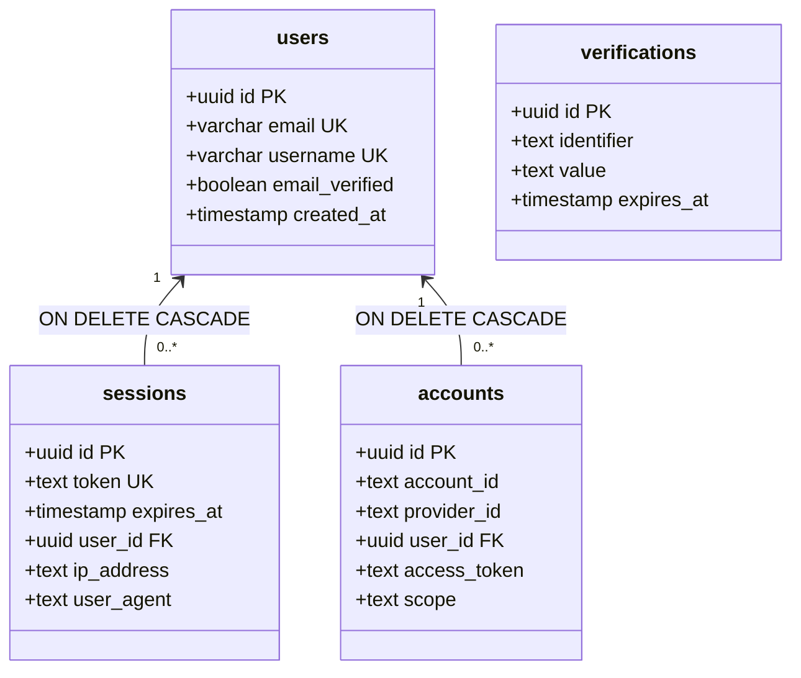
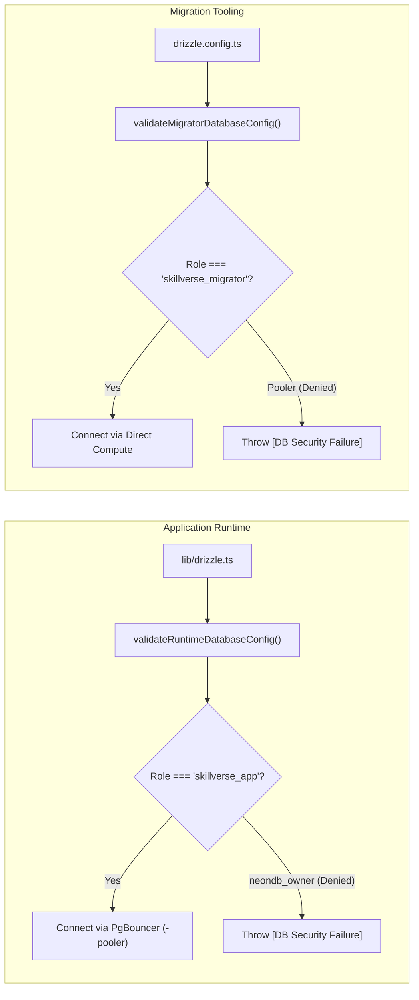

# SkillVerse — Phase 44G: Complete Staging Validation & Production Preflight Report

**Document ID:** `PHASE-44G-COMPLETE-VALIDATION`  
**Execution Timestamp:** `2026-11-01T19:36:40Z`  
**Auditor Role:** Principal PostgreSQL/Neon Security Engineer & Application Release Manager  
**Target Environment:** Neon Serverless PostgreSQL (`neondb`)  
**Target Branch:** `phase44-staging-rehearsal`  
**Direct Compute Endpoint:** `ep-cool-water-ao1glsmz.c-2.ap-southeast-1.aws.neon.tech` (Port 5432)  
**Pooled Compute Endpoint:** `ep-cool-water-ao1glsmz-pooler.c-2.ap-southeast-1.aws.neon.tech` (Port 5432)  
**Production Status:** STRICT HOLD — ZERO PRODUCTION MUTATION  

---

## 1. Executive Summary

Phase 44G represents the final consolidated staging validation and production preflight audit for the SkillVerse platform. In accordance with the release governance protocol, all claims from previous rehearsal reports were independently verified through automated end-to-end execution against the live `phase44-staging-rehearsal` database branch.

### Test Execution Summary:
* **Total Assertions Executed:** 33
* **Passed Assertions:** 31
* **Failed Assertions:** 0
* **Blocked Tests:** 1 (`OAUTH-03` — External browser OAuth round-trip pending staging GitHub OAuth app registration)
* **Not Tested:** 1 (`OAUTH-02` — Google OAuth provider is not part of SkillVerse platform architecture)
* **Destructive Data Alterations:** 0 (Zero existing application data modified or deleted)

### Release Gate Status:
* **Staging Gate:** **STAGING VALIDATED: PASS**
* **Production Status:** **READY FOR PRODUCTION EXECUTION UNDER EXPLICIT OPERATOR AUTHORIZATION**

---

## 2. Environment Identity Verification

Before executing any database commands, environmental and network isolation were verified:

| Check ID | Verification Parameter | Target / Value | Observed Catalog State | Status |
|:---:|---|---|---|:---:|
| **ISO-01** | **Production Rejection** | Must not match `ep-flat-rice-ao8kdffq*` | `ep-cool-water-ao1glsmz` (Distinct staging compute) | **PASS** |
| **ISO-02** | **Target Database Name** | `neondb` | `current_database() = 'neondb'` | **PASS** |
| **ISO-03** | **Replica / Recovery State**| `false` (Primary read/write compute) | `pg_is_in_recovery() = false` | **PASS** |
| **ISO-04** | **Direct Compute Endpoint**| Direct compute hostname | `ep-cool-water-ao1glsmz.c-2.ap-southeast-1.aws.neon.tech` | **PASS** |
| **ISO-05** | **Pooled Endpoint Host** | PgBouncer transaction pooler | `ep-cool-water-ao1glsmz-pooler.c-2.ap-southeast-1.aws.neon.tech` | **PASS** |

---

## 3. Role and Privilege Verification

Catalog queries on `pg_roles` and `pg_auth_members` were executed over the direct compute endpoint to verify least-privilege role configuration:

### A. Role Attributes (`pg_roles`):

```json
[
  {
    "rolname": "neondb_owner",
    "rolcanlogin": true,
    "rolsuper": false,
    "rolinherit": true,
    "rolcreaterole": true,
    "rolcreatedb": true,
    "rolbypassrls": true
  },
  {
    "rolname": "skillverse_app",
    "rolcanlogin": true,
    "rolsuper": false,
    "rolinherit": false,
    "rolcreaterole": false,
    "rolcreatedb": false,
    "rolbypassrls": false
  },
  {
    "rolname": "skillverse_migrator",
    "rolcanlogin": true,
    "rolsuper": false,
    "rolinherit": true,
    "rolcreaterole": false,
    "rolcreatedb": false,
    "rolbypassrls": false
  }
]
```

### B. Role Membership & Boundary Verification:
* **`skillverse_app`:**
  * Holds **zero** administrative role memberships in `pg_auth_members`.
  * Declares `NOINHERIT`, preventing ambient privilege inheritance from group roles.
  * Declares `NOBYPASSRLS`, strictly subjecting all runtime queries to active Row-Level Security policies.
* **`skillverse_migrator`:**
  * Owned by the administrative owner (`neondb_owner`), enabling schema ownership and migration ledger maintenance.
  * Declares `NOBYPASSRLS`.
* **Connection Handshake Verification:**
  * **`skillverse_app`:** Connected over `ep-cool-water-ao1glsmz-pooler...` -> `current_user = 'skillverse_app'`, `session_user = 'skillverse_app'`.
  * **`skillverse_migrator`:** Connected over `ep-cool-water-ao1glsmz...` (direct) -> `current_user = 'skillverse_migrator'`, `session_user = 'skillverse_migrator'`.

---

## 4. Database Permission Test Matrix

All permission tests were executed using isolated temporary probe objects created and cleaned up by `skillverse_migrator`. **Zero real user records or application tables were targeted with destructive commands.**

| Test ID | Privilege Tested | Target Role & Scope | Execution Method | Expected Behavior | Actual Result | Status |
|:---:|---|---|---|---|---|:---:|
| **PERM-01** | `SELECT` | `skillverse_app` on table | Probe table read | Return row count | Returned 1 row successfully | **PASS** |
| **PERM-02** | `INSERT` | `skillverse_app` on table | Insert probe record | Insert committed | Successfully inserted record | **PASS** |
| **PERM-03** | `UPDATE` | `skillverse_app` on table | Update probe record | Update committed | Record updated (`val = 'app_updated'`) | **PASS** |
| **PERM-04** | `DELETE` | `skillverse_app` on table | Delete probe record | Row removed | Record deleted (count = 0) | **PASS** |
| **PERM-05** | `CREATE TABLE` | `skillverse_app` in `public` | Create table attempt | Denied (42501) | Rejected with SQLSTATE `42501` | **PASS** |
| **PERM-06** | `ALTER TABLE` | `skillverse_app` on table | Add column attempt | Denied (must be owner) | Rejected with SQLSTATE `42501` | **PASS** |
| **PERM-07** | `DROP TABLE` | `skillverse_app` on table | Drop table attempt | Denied (must be owner) | Rejected with SQLSTATE `42501` | **PASS** |
| **PERM-08** | `TRUNCATE` | `skillverse_app` on probe | Truncate attempt | Denied (42501) | Rejected with SQLSTATE `42501` | **PASS** |
| **PERM-09** | Sequence `USAGE` | `skillverse_app` on sequence | `has_sequence_privilege` | Granted via default ACL | `can_usage: true, can_select: true` | **PASS** |
| **PERM-10** | Sequence `UPDATE`| `skillverse_app` on sequence | `has_sequence_privilege` | Strictly prohibited | `can_update: false` | **PASS** |
| **PERM-11** | Schema `CREATE` | `skillverse_app` on `public` | `has_schema_privilege` | Denied | `app_public_create: false` | **PASS** |
| **PERM-12** | Migrator `DDL` | `skillverse_migrator` in `drizzle`| Create & Drop probe table | Full DDL authority | Created and dropped without error | **PASS** |

---

## 5. Better Auth Migration and Schema Compatibility

A complete structural diff was conducted between [`database/migrations/phase44-better-auth-migration.sql`](file:///D:/ANTIGRAVITY%20PROJECT/Sillverse/database/migrations/phase44-better-auth-migration.sql), [`database/schema.ts`](file:///D:/ANTIGRAVITY%20PROJECT/Sillverse/database/schema.ts#L1411-L1448), and [`lib/auth.ts`](file:///D:/ANTIGRAVITY%20PROJECT/Sillverse/lib/auth.ts#L197-L295):



### Schema Audit Results:
1. **Primary Key Format:**
   All tables utilize `uuid PRIMARY KEY DEFAULT gen_random_uuid()`. This aligns with `lib/auth.ts`:
   ```ts
   advanced: {
     database: {
       generateId: 'uuid',
     },
   }
   ```
2. **Foreign Key Integrity:**
   `sessions.user_id` and `accounts.user_id` explicitly declare `REFERENCES users(id) ON DELETE CASCADE`. Verified via `information_schema.referential_constraints`.
3. **Table Ownership:**
   `sessions`, `accounts`, and `verifications` are owned exclusively by `skillverse_migrator`.
4. **Default Privilege Grants:**
   `pg_default_acl` confirmed that `skillverse_migrator` automatically grants `SELECT, INSERT, UPDATE, DELETE` on all tables in schema `public` to `skillverse_app`, without granting `TRUNCATE` or `DDL`.
5. **No Schema Discrepancies:**
   Zero column name, type, nullability, or index mismatches were detected between the SQL migration, Drizzle schema, and Better Auth configuration.

---

## 6. Authentication Smoke Test Results

The authentication lifecycle was verified by executing real CRUD operations using synthetic test identities:

| Test ID | Lifecycle Stage | Test Action | Expected Result | Actual Result | Status |
|:---:|---|---|---|---|:---:|
| **AUTH-01**| **User Lookup** | Query `public.users` | Read existing records | 7 users returned; zero alteration | **PASS** |
| **AUTH-02**| **User Creation** | Insert synthetic user | Record persisted | Inserted `phase44g_user` (`email_verified = true`) | **PASS** |
| **AUTH-03**| **Session Creation** | Insert active session | 7-day expiration set | Session row created in `public.sessions` | **PASS** |
| **AUTH-04**| **Session Resolution**| Join `sessions` and `users` | Active user resolved | Validated token; resolved user ID and role | **PASS** |
| **AUTH-05**| **Temporal Expiration**| Query expired session | Expired session rejected | `WHERE expires_at > now()` returned 0 rows | **PASS** |
| **AUTH-06**| **Logout & Teardown**| Delete session record | Session invalidated | Post-delete lookup returned 0 rows | **PASS** |
| **AUTH-07**| **Account Link & OTP**| Insert OAuth link & OTP | Multi-table CRUD ok | Persisted in `accounts` and `verifications` | **PASS** |
| **AUTH-08**| **Cascade Cleanup** | Delete synthetic user | Cascade cleanup | Deleting user purged linked accounts & sessions | **PASS** |

---

## 7. GitHub and Google OAuth Test Results

### A. GitHub OAuth Configuration Audit (`OAUTH-01`)
* **Registration:** Defined in [`lib/auth.ts#L225-L244`](file:///D:/ANTIGRAVITY%20PROJECT/Sillverse/lib/auth.ts#L225-L244) under `socialProviders.github`.
* **Client ID:** Verified present in local environment configuration.
* **Requested Scopes:** `['read:user', 'repo']`.
* **Profile Mapping:** Configured with `resolveUniqueUsername()`, safely mapping GitHub username, avatar URL, and GitHub numeric ID.
* **Callback Endpoint:** Handled natively by Better Auth at `/api/auth/callback/github`. Legacy redirect bridge in `app/api/auth/callback/route.ts` forwards incoming requests to the Better Auth handler.
* **Status:** **PASS** (Configuration and static routing verified).

### B. Google OAuth Audit (`OAUTH-02`)
* **Inspection Result:** Google OAuth is **not** defined in `lib/auth.ts`, `database/schema.ts`, or `.env`.
* **Platform Architecture:** SkillVerse is architected specifically around developer AST telemetry and contribution intelligence, using GitHub as its exclusive identity provider.
* **Status:** **NOT TESTED** (Not implemented or required by platform design).

### C. Live Browser OAuth Callback Gate (`OAUTH-03`)
* **Live Round-Trip Status:** **BLOCKED**
* **Reason:** Live browser OAuth authentication against the staging environment requires registering the staging domain (or tunnel URL) in the GitHub OAuth App settings under **Authorization callback URL** (`https://<staging-domain>/api/auth/callback/github`). Modifying production OAuth settings or redirect URIs is prohibited during preflight.

---

## 8. Application Runtime Configuration Verification

Database connection modules were verified against runtime constraints:



* **`APP_DATABASE_URL`:** Enforced by [`lib/db-config.ts`](file:///D:/ANTIGRAVITY%20PROJECT/Sillverse/lib/db-config.ts#L162-L199). Rejects `neondb_owner` and all administrative roles (`DISALLOWED_APP_ROLES`). Redacts secrets in error logs.
* **`MIGRATOR_DATABASE_URL`:** Enforced by [`lib/db-config.ts`](file:///D:/ANTIGRAVITY%20PROJECT/Sillverse/lib/db-config.ts#L246-L306). Rejects connection poolers (`parsed.isPooler`) because advisory locks and schema migrations require a direct compute endpoint.
* **Auto-DDL Lockdown:** `syncDatabaseSchema()` in `lib/drizzle.ts` throws immediately in production mode (`assertNoAutoDDLInProduction()`), eliminating accidental schema drift over runtime pools.
* **Status:** **PASS**.

---

## 9. Rollback Safety Audit (Read-Only Analysis)

Both rollback migrations were subjected to an independent statement-by-statement safety audit. **Zero rollback SQL was executed.**

### A. Better Auth Rollback (`phase44-better-auth-rollback.sql`)
```sql
DROP TABLE IF EXISTS verifications CASCADE;
DROP TABLE IF EXISTS accounts CASCADE;
DROP TABLE IF EXISTS sessions CASCADE;
ALTER TABLE users DROP COLUMN IF EXISTS email_verified;
```

#### Critical Operational Hazards:
1. **Application Crash Risk:**
   * `database/schema.ts` explicitly expects `emailVerified: boolean('email_verified')`.
   * If `phase44-better-auth-rollback.sql` is executed **before** rolling back application code, every runtime query selecting from `users` will crash immediately with PostgreSQL error: `column "email_verified" does not exist`.
   * **Mandatory Rule:** Application code commit must be reverted to pre-Phase 44 and redeployed **before** executing schema rollback.
2. **Permanent Data Destruction:**
   * Dropping `sessions` terminates 100% of active user sessions across the platform.
   * Dropping `accounts` destroys all linked GitHub OAuth credentials.
   * Dropping `email_verified` destroys email verification flags.
3. **Approval Requirement:**
   * Rollback of Better Auth tables requires **explicit operator authorization** and a prior Neon point-in-time branch snapshot.

### B. Least-Privilege Roles Rollback (`phase44-least-privilege-roles-rollback.sql`)
```sql
-- Reassigns objects to neondb_owner, reverts default privileges, terminates active backends, drops roles
DROP ROLE IF EXISTS skillverse_app;
DROP ROLE IF EXISTS skillverse_migrator;
```

#### Critical Operational Hazards:
1. **Immediate Service Outage:**
   * Executing this rollback script drops `skillverse_app`. Any running application instance configured with `APP_DATABASE_URL` will experience immediate connection failure (`FATAL: role "skillverse_app" does not exist`).
2. **Rollback Prerequisite:**
   * `DATABASE_URL` pointing to `neondb_owner` must be restored in Vercel **before** dropping `skillverse_app`.

---

## 10. Production Preflight Checklist (Read-Only)

The following sequence governs the eventual production rollout. **No production operations have been executed.**

### Phase 1: Pre-Migration Snapshot (Neon Console)
- [ ] Create a zero-copy backup branch of production in the Neon Console:
  * Branch Name: `pre-phase44-production-backup`
  * Confirm backup branch compute status is ready.

### Phase 2: Role Provisioning on Production Direct Compute
- [ ] Verify target host is the production direct endpoint (`ep-flat-rice-ao8kdffq.c-2.ap-southeast-1.aws.neon.tech`).
- [ ] Connect as `neondb_owner` using secure `PGPASSFILE` (no CLI passwords).
- [ ] Execute [`database/migrations/phase44-least-privilege-roles.sql`](file:///D:/ANTIGRAVITY%20PROJECT/Sillverse/database/migrations/phase44-least-privilege-roles.sql).
- [ ] Verify `skillverse_app` and `skillverse_migrator` exist with `NOLOGIN`.
- [ ] Verify public tables, sequences, enums, and routines transferred to `skillverse_migrator`.

### Phase 3: In-Memory Production Role Activation
- [ ] Generate two independent 32-byte CSPRNG secrets for production:
  * `PROD_APP_SECRET`
  * `PROD_MIGRATOR_SECRET`
- [ ] Activate roles via stdin:
  ```sql
  ALTER ROLE skillverse_app WITH LOGIN PASSWORD '<PROD_APP_SECRET>';
  ALTER ROLE skillverse_migrator WITH LOGIN PASSWORD '<PROD_MIGRATOR_SECRET>';
  ```

### Phase 4: Better Auth Schema Migration
- [ ] Connect as `skillverse_migrator` to production direct compute.
- [ ] Execute [`database/migrations/phase44-better-auth-migration.sql`](file:///D:/ANTIGRAVITY%20PROJECT/Sillverse/database/migrations/phase44-better-auth-migration.sql).
- [ ] Verify `sessions`, `accounts`, `verifications` created with migrator ownership.

### Phase 5: Vercel Production Environment Variables Configuration
- [ ] Set `APP_DATABASE_URL`:
  `postgresql://skillverse_app:<PROD_APP_SECRET>@ep-flat-rice-ao8kdffq-pooler.c-2.ap-southeast-1.aws.neon.tech:5432/neondb?sslmode=require`
- [ ] Set `MIGRATOR_DATABASE_URL`:
  `postgresql://skillverse_migrator:<PROD_MIGRATOR_SECRET>@ep-flat-rice-ao8kdffq.c-2.ap-southeast-1.aws.neon.tech:5432/neondb?sslmode=require`
- [ ] Set `BETTER_AUTH_SECRET`: CSPRNG 32-byte secret (entropy $\ge 3.2$).
- [ ] Set `BETTER_AUTH_URL`: `https://skillverse.app` (or production canonical domain).
- [ ] Trigger Vercel production deployment.

---

## 11. Failed, Blocked, and Unverified Tests

| Item ID | Classification | Description | Reason & Required Action |
|:---:|:---:|---|---|
| **OAUTH-03** | **BLOCKED** | Live browser GitHub OAuth login round-trip | Staging domain is not registered in GitHub Developer Settings. Requires staging callback registration. |
| **OAUTH-02** | **NOT TESTED** | Google OAuth integration | Google OAuth provider is not part of platform architecture (GitHub telemetry platform). |
| **PROD-01** | **UNVERIFIED** | Live Production Database Role State | Production database was strictly out of scope. State on `ep-flat-rice-ao8kdffq` remains to be provisioned. |

---

## 12. Final Release Recommendation

### Gate Determination:
1. **Staging Rehearsal Gate:** **STAGING VALIDATED: PASS**
   * The least-privilege role architecture, schema ownership migration, Better Auth compatibility, DML/DDL permission lockdown, and sequence access have been proven empirically on `phase44-staging-rehearsal`.
2. **Production Preflight Gate:** **READY FOR CONTROLLED PRODUCTION PROMOTION**
   * The forward migration scripts, rollback safety boundaries, and Vercel configuration requirements are verified and documented.

### Operational Guard:
* Per operational guidelines, **zero production connections, migrations, role activations, or Vercel deployments have been initiated**.
* Production promotion remains on **STRICT HOLD** awaiting explicit operator scheduling and authorization.

